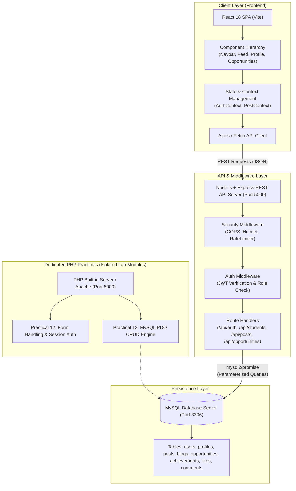
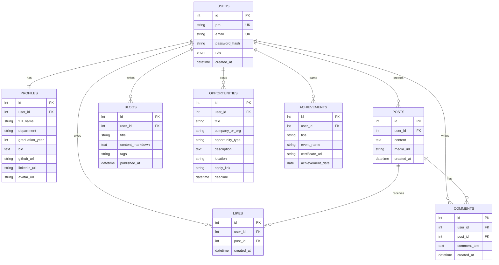

# KBTCOE Connect — Master Development Plan

## 1. Executive Summary & Vision

**KBTCOE Connect** is a professional networking and opportunity-sharing platform designed for students, faculty, and alumni of **MVP Samaj's K.B.T. College of Engineering (KBTCOE), Nashik**.

### Tagline
> **"The Professional Network for KBTCOE Students"**

### Primary Mission
To provide an academic and career-focused digital campus environment where students can:
1. Showcase verified academic credentials, branch, semester, and technical skills.
2. Publish technical articles, tutorials, and project case studies.
3. Post achievements, certifications, and hackathon milestones.
4. Discover internships, campus drives, and peer collaboration opportunities.
5. Interact professionally via feeds, project updates, likes, and technical discussions.
6. Search student directories by engineering branch, skill set, and graduation batch.

The project is structured to meet rigorous academic laboratory standards across **16 university practical assignments**, building progressively from core web fundamentals (HTML/CSS/JS) through modern frontend architectures (React SPA), dedicated backend engines (PHP form handling & PDO CRUD), and modern enterprise web stacks (Node.js, Express.js REST APIs, and MySQL).

---

## 2. Comprehensive System Architecture

---

## 3. UI/UX Design System Specifications

To ensure visual consistency and professional aesthetics across all 16 deliverables:

### Color Palette
- **Primary Navy:** `#1E3A8A` (Deep Academic Blue — headers, branding, primary buttons)
- **Secondary Blue:** `#2563EB` (Interactive highlights, active navigation links, tabs)
- **Accent Cyan:** `#0284C7` (Skill tags, badges, status indicators)
- **Background Slate:** `#F8FAFC` (Canvas body background, contrast surface)
- **Card Surface:** `#FFFFFF` (Elevated card containers, borders with `#E2E8F0`)
- **Text High-Contrast:** `#0F172A` (Headings, primary typography)
- **Text Muted:** `#64748B` (Sub-headers, timestamps, secondary details)
- **Success Green:** `#16A34A` (Opportunity open, verification badges)
- **Danger Red:** `#DC2626` (Validation errors, delete triggers)

### Typography & Spacing
- **Primary Font Family:** System UI stack: `Inter, -apple-system, BlinkMacSystemFont, "Segoe UI", Roboto, sans-serif`.
- **Base Font Size:** `16px` (1rem); Line-height: `1.5`.
- **Spacing Grid:** 4px base (`4px`, `8px`, `12px`, `16px`, `24px`, `32px`, `48px`).
- **Card Radii:** `8px` (`0.5rem`) for subtle, modern rounded corners.
- **Card Elevation:** Subtle dropshadow: `box-shadow: 0 1px 3px 0 rgba(0, 0, 0, 0.1), 0 1px 2px 0 rgba(0, 0, 0, 0.06)`.

### Responsive Breakpoints
- **Mobile (`xs`/`sm`):** `< 640px` (Single column, toggle drawer navigation, full-width cards).
- **Tablet (`md`):** `640px – 1024px` (Two-column layout, compact sidebar, icon-assisted nav).
- **Desktop (`lg`/`xl`):** `> 1024px` (Three-column layout: Left User Card, Center Feed/Content, Right Announcements/Opportunities).

---

## 4. Relational Database Schema Design (MySQL)

---

## 5. Detailed Breakdown of 16 Practical Assignments

### Assignment 01: HTML Basics (`01-HTML_Basics`)
- **Aim:** Build the foundational HTML markup for the KBTCOE Connect portal landing page.
- **Syllabus Concepts:** Document layout (`<!DOCTYPE html>`, `<html>`, `<head>`, `<body>`), hierarchical headings (`<h1>` to `<h3>`), text formatting, unordered/ordered lists, hyperlinks, images, and structured tables.
- **KBTCOE Connect Application:**
  - Student Welcome Hub with college branding.
  - Profile Summary table displaying student details (PRN, Branch, Year, Skills).
  - Departmental announcement list and opportunity bulletin table.
- **Key Deliverables:** `index.html`, `README.md` (with 5 viva questions & run guide).
- **Verification:** HTML5 validation check, browser rendering check.

---

### Assignment 02: Semantic HTML (`02-Semantic_HTML`)
- **Aim:** Refactor the platform using modern HTML5 semantic elements to maximize accessibility, SEO, and structural clarity.
- **Syllabus Concepts:** `<header>`, `<nav>`, `<main>`, `<article>`, `<section>`, `<aside>`, `<footer>`, `<figure>`, `<figcaption>`, `<time>`, `<mark>`.
- **KBTCOE Connect Application:**
  - Semantic Student Profile & Technical Article Showcase.
  - Multi-section page layout containing main article feed, upcoming hackathons sidebar (`<aside>`), departmental navigation bar (`<nav>`), and institution footer (`<footer>`).
- **Key Deliverables:** `index.html`, `README.md`.
- **Verification:** Semantic outline verification, accessibility audit.

---

### Assignment 03: CSS Styling (`03-CSS_Styling`)
- **Aim:** Style the semantic KBTCOE Connect portal into an aesthetically pleasing, professional web interface using CSS3.
- **Syllabus Concepts:** CSS selectors (element, class, id, attribute, pseudo-classes), Box Model (content, padding, border, margin), typography styling, color schemes, card shadows, rounded corners, button styles.
- **KBTCOE Connect Application:**
  - KBTCOE Navy & Blue Design System implementation.
  - Styled Student Profile Badges, verified skill tags, polished call-to-action buttons, and clean post cards.
- **Key Deliverables:** `index.html`, `style.css`, `README.md`.
- **Verification:** Box model verification, cross-browser visual rendering.

---

### Assignment 04: Responsive Web Design (`04-Responsive_Design`)
- **Aim:** Implement responsive web design combining modern CSS Flexbox, CSS Grid, and media queries for fluid multi-device layouts.
- **Syllabus Concepts:** CSS Media Queries (`@media`), Viewport meta tag, relative CSS units (`rem`, `em`, `%`, `vw`, `vh`), CSS Flexbox (`flex-direction`, `justify-content`, `align-items`, `flex-wrap`), CSS Grid (`grid-template-columns`, `gap`, `grid-template-areas`), mobile-first design, fluid imagery.
- **KBTCOE Connect Application:**
  - Adaptive Student Feed and Layout combining CSS Grid for page scaffolding and Flexbox for component alignment.
  - Multi-column feed that dynamically reflows across mobile (<640px), tablet (640-1024px), and desktop (>1024px).
  - Mobile-responsive navigation bar with toggleable drawer.
- **Key Deliverables:** `index.html`, `responsive.css`, `README.md`.
- **Verification:** Viewport resizing test across 320px, 768px, and 1280px widths.

---

### Assignment 05: CSS Positioning & Other CSS Properties (`05-CSS_Positioning`)
- **Aim:** Master CSS positioning schemes (`static`, `relative`, `absolute`, `fixed`, `sticky`) and other essential CSS properties (transforms, transitions, overflow, z-index, filters, opacity).
- **Syllabus Concepts:** CSS `position` schemes (`static`, `relative`, `absolute`, `fixed`, `sticky`), `z-index` stacking context, clip/overflow control, CSS transforms (`translate`, `scale`, `rotate`), transitions, box shadows, and pseudo-elements (`::before`, `::after`).
- **KBTCOE Connect Application:**
  - Sticky top header navigation bar pinned on scroll.
  - Floating action button (FAB) with `fixed` positioning.
  - Interactive "New Post" modal overlay dialog with `absolute` centering and backdrop overlay.
  - Profile avatar online/status badges (`absolute` relative to avatar container).
- **Key Deliverables:** `index.html`, `positioning.css`, `README.md`.
- **Verification:** Scroll behavior testing, modal overlay stacking test, CSS transform verification.

---

### Assignment 06: JavaScript Basics (`06-JavaScript_Basics`)
- **Aim:** Introduce client-side JavaScript logic to enable dynamic student directory search and filtering.
- **Syllabus Concepts:** Variables (`const`, `let`), data types, arrays, objects, functions (arrow functions), ES6 array methods (`filter`, `map`, `reduce`, `find`), event listeners (`addEventListener`).
- **KBTCOE Connect Application:**
  - In-memory data store of KBTCOE students across branches.
  - Real-time search by student name/PRN and department filter buttons.
  - Statistical summary counter (e.g., total registered students, department counts computed via `reduce`).
- **Key Deliverables:** `index.html`, `app.js`, `style.css`, `README.md`.
- **Verification:** Filter execution speed and console error checking.

---

### Assignment 07: Frontend Validation (`07-Frontend_Validation`)
- **Aim:** Implement comprehensive client-side form validation with instant user feedback and configurable validation rules.
- **Syllabus Concepts:** HTML5 constraint validation API, JavaScript form event handling (`submit`, `input`, `blur`), Regular Expressions (RegEx), configurable rule definitions, custom error messages, visual validation cues (red/green borders).
- **KBTCOE Connect Application:**
  - Student Registration Form with configurable institutional validation rules:
    - Institutional Email pattern (configurable regex, e.g. supporting `@kbtcoe.org` or custom campus domain).
    - University PRN pattern (configurable format/length definition).
    - Password complexity rules (configurable length, uppercase, digit, and symbol requirements).
    - Graduation Year range check (configurable min/max range).
- **Key Deliverables:** `index.html`, `validation.js`, `style.css`, `README.md`.
- **Verification:** Negative and positive test cases for each form field using configurable rule objects.

---

### Assignment 08: React Single Page Application (`08-React_SPA`)
- **Aim:** Set up a modern React Single Page Application (SPA) architecture with modular component hierarchy.
- **Syllabus Concepts:** Modern build tools (Vite), React functional components, JSX syntax, virtual DOM, client-side routing concepts, project directory structuring.
- **KBTCOE Connect Application:**
  - Initialized KBTCOE Connect React application.
  - Modular components: `Header`, `Navigation`, `ProfileCard`, `Feed`, `OpportunityList`, and `Footer`.
  - Multi-view routing (Feed view, Directory view, Opportunities view).
- **Key Deliverables:** React Vite project in `assignments/08-React_SPA/`, `README.md`.
- **Verification:** Vite build & dev server runtime check (`npm run dev` / `npm run build`).

---

### Assignment 09: Core React Concepts (`09-React_Concepts`)
- **Aim:** Implement state management, component lifecycle effects, and props propagation in React.
- **Syllabus Concepts:** `useState` hook for local state, `useEffect` hook for lifecycle/side-effects, unidirectional data flow, props destructuring, controlled form inputs, custom reusable hooks.
- **KBTCOE Connect Application:**
  - Interactive Student Feed: stateful post creation, like toggles with animated counts, dynamic skill tag selector.
  - Controlled forms for publishing technical posts.
- **Key Deliverables:** React components, state hooks, `README.md`.
- **Verification:** Component state persistence, re-render verification.

---

### Assignment 10: Asynchronous Fetch API & JSON (`10-Fetch_API_JSON`)
- **Aim:** Consume asynchronous RESTful JSON endpoints using modern JavaScript Fetch API and `async`/`await`.
- **Syllabus Concepts:** Asynchronous programming, JavaScript Promises, `async/await` syntax, Fetch API (`GET`, `POST`), JSON serialization/deserialization, loading spinners, network error handling (`try...catch`).
- **KBTCOE Connect Application:**
  - Asynchronous Opportunity Board fetching internship listings from a mock JSON server / endpoint.
  - Technical Blog reader loading external JSON data with clean skeleton loading state and error retry boundary.
- **Key Deliverables:** `index.html`, `fetch-app.js`, `data.json`, `style.css`, `README.md`.
- **Verification:** Simulated network delay test, error boundary trigger test.

---

### Assignment 11: DOM Manipulation (`11-DOM_Manipulation`)
- **Aim:** Execute dynamic, imperatively controlled DOM operations without full page reloads.
- **Syllabus Concepts:** Document Object Model traversal (`querySelector`, `closest`, `parentElement`), element creation (`document.createElement`), attribute modification, event delegation, DOM fragment appending.
- **KBTCOE Connect Application:**
  - Dynamic Post Interaction Engine: add comments dynamically to a post thread, bookmark posts, toggle expandable content ("Read more"), remove items with smooth DOM transitions.
- **Key Deliverables:** `index.html`, `dom.js`, `style.css`, `README.md`.
- **Verification:** Memory leak prevention check, event delegation efficiency.

---

### Assignment 12: PHP Form Handling & Session Management (`12-PHP_Form_Handling`)
- **Aim:** Implement server-side form processing, data sanitization, validation, and session-based authentication in PHP.
- **Syllabus Concepts:** PHP superglobals (`$_POST`, `$_GET`, `$_SESSION`, `$_SERVER`), data sanitization (`htmlspecialchars`, `filter_var`), server-side validation, session lifecycle (`session_start()`, session destruction), flash messaging.
- **KBTCOE Connect Application:**
  - Student Profile & Blog Submission module in PHP.
  - Session-based login simulation restricting article publishing to authenticated students.
- **Key Deliverables:** `index.php`, `login.php`, `submit-blog.php`, `dashboard.php`, `style.css`, `README.md`.
- **Verification:** PHP built-in server test (`php -S localhost:8000`), session security check.

---

### Assignment 13: PHP-MySQL Database Connectivity & CRUD (`13-PHP_MySQL_CRUD`)
- **Aim:** Develop a full database-driven CRUD application using PHP and MySQL with prepared statements.
- **Syllabus Concepts:** PHP Data Objects (PDO), database connection pooling, SQL injection prevention via prepared statements, CRUD operations (Create, Read, Update, Delete), SQL error handling.
- **KBTCOE Connect Application:**
  - KBTCOE Opportunities Management Portal:
    - Post a new internship or campus drive (Create).
    - View active opportunities with department filters (Read).
    - Edit existing opportunity details and deadline (Update).
    - Archive or delete closed opportunities (Delete).
- **Key Deliverables:** `config.php`, `index.php`, `create.php`, `edit.php`, `delete.php`, `schema.sql`, `README.md`.
- **Verification:** Full CRUD lifecycle test, SQL injection vulnerability test.

---

### Assignment 14: Node.js & Express REST Server (`14-Node_Express_Server`)
- **Aim:** Build a modular, production-ready REST API server using Node.js and Express.js.
- **Syllabus Concepts:** Node.js runtime, NPM package management, Express application lifecycle, middleware pipeline (`cors`, `express.json`, `morgan`), RESTful route architecture, HTTP status codes, centralized error handling.
- **KBTCOE Connect Application:**
  - Express REST API Gateway for KBTCOE Connect:
    - `GET /api/health` — Server health monitoring.
    - `GET /api/students` & `GET /api/students/:id` — Student directory.
    - `GET /api/posts` & `POST /api/posts` — Feed updates.
    - `GET /api/opportunities` — Job & internship listings.
- **Key Deliverables:** `server.js`, `routes/`, `controllers/`, `package.json`, `README.md`.
- **Verification:** API endpoint tests with curl/Fetch, middleware response time check.

---

### Assignment 15: REST API with MySQL Database (`15-REST_API_Database`)
- **Aim:** Integrate the Node.js/Express backend with a persistent MySQL database, complete with JWT authentication and parameterized SQL queries.
- **Syllabus Concepts:** `mysql2/promise` connection pool, SQL schema execution, password hashing with `bcryptjs`, JSON Web Tokens (JWT) for stateless authentication, protected API routes, input validation with `express-validator`.
- **KBTCOE Connect Application:**
  - Complete backend authentication flow (Register, Login, Token refresh).
  - Protected endpoints for updating student profiles, publishing verified achievements, and posting comments.
- **Key Deliverables:** `server.js`, `db.js`, `routes/auth.js`, `routes/profiles.js`, `routes/posts.js`, `README.md`.
- **Verification:** Token expiration check, SQL injection resistance, relational integrity verification.

---

### Assignment 16: KBTCOE Connect Full-Stack Capstone (`16-KBTCOE_Connect_Final_Project`)
- **Aim:** Integrate the React SPA frontend, Express REST API backend, and MySQL database into a cohesive, high-performance, fully demonstrable production application.
- **Syllabus Concepts:** Full-stack integration, environment variable management, CORS configuration, responsive design polish, state synchronization, client-side route guards, administrative moderation, production build optimization.
- **KBTCOE Connect Application:**
  - Complete, end-to-end KBTCOE Connect platform:
    - Real-time student onboarding with college email verification.
    - Profile management with skill badges and GitHub/LinkedIn integration.
    - Live feed with technical posts, markdown blog reader, likes, and nested comments.
    - Opportunities portal with application tracking.
    - Student directory with multi-criteria search and filter.
    - Moderation tools to flag and remove inappropriate posts.
- **Key Deliverables:** Integrated `frontend/`, `backend/`, `database/`, comprehensive test suite, `README.md`, presentation slides outline.
- **Verification:** End-to-end user journey test, clean-environment deployment test.

---

## 6. Security & Data Integrity Protocol

1. **Authentication:**
   - Password Hashing: `bcryptjs` with salt round >= 10.
   - Stateless Tokens: JWT signed with HMAC SHA-256 (`HS256`), configurable expiration (24h).
   - Authorization Headers: `Authorization: Bearer <token>`.

2. **Database Security:**
   - Always use parameterized queries (`?` placeholders in `mysql2` and named placeholders `:param` in PDO).
   - Zero dynamic string concatenation in SQL queries.

3. **Input Sanitization & Validation:**
   - Frontend validation via HTML5 attributes and RegEx for instant UI feedback.
   - Backend validation via `express-validator` and PHP `filter_var()` as the ultimate source of truth.
   - Cross-Site Scripting (XSS) prevention: escaping output (`htmlspecialchars` in PHP, JSX automatic escaping in React).

4. **Environment Variables:**
   - Stored in `.env` files; `.env.example` templates committed to Git; real `.env` files kept in `.gitignore`.

---

## 7. Coach & Viva Defense Guide

During practical examinations and project reviews, students will be questioned on both theoretical concepts and architectural decisions.

### Core Viva Topics Covered
1. **HTML/CSS:** Semantic tags vs `
`, CSS Box Model, specificity calculation, Flexbox vs Grid trade-offs, media query syntax.
2. **JavaScript:** Scope (`let` vs `var` vs `const`), closure, event bubbling vs capturing, Promises vs `async/await`, array immutability.
3. **React:** Virtual DOM reconciliation, why keys are needed in lists, rules of hooks, controlled vs uncontrolled inputs, lifting state up.
4. **PHP & Database:** Server-side vs client-side validation, SQL injection prevention, PDO vs mysqli, session fixation and handling.
5. **Node.js & Express:** Event loop architecture, non-blocking I/O, middleware sequencing, CORS origins, REST resource naming conventions.
6. **Security:** Salting and hashing passwords, JWT structure (Header, Payload, Signature), token storage strategies (localStorage vs HttpOnly cookies).

---

## 8. Milestone Execution Protocol

- **Step 1:** Complete Assignment 01 (`01-HTML_Basics`) -> Create files, test locally, generate viva questions -> Log in `PROGRESS.md`.
- **Step 2:** Request user review and approval before proceeding to the subsequent assignment.
- **Step 3:** Repeat sequence until Assignment 16 is fully integrated, verified, and ready for deployment.
