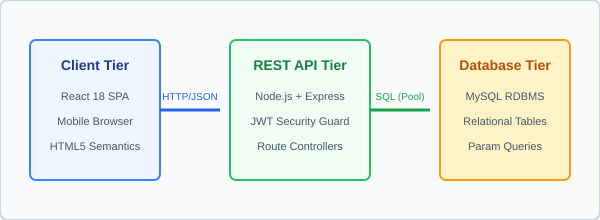

# Assignment 02 — Semantic HTML

## 1. Assignment Metadata

- **Assignment Number:** 02
- **Title:** Semantic HTML
- **Module:** KBTCOE Connect — Semantic Campus Portal & Technical Article Showcase
- **Course / Lab:** Web Development Laboratory
- **Institution:** MVP Samaj's K.B.T. College of Engineering (KBTCOE), Nashik
- **Status:** Complete & Verified

---

## 2. Aim

To re-architect and develop a semantic HTML5 version of **KBTCOE Connect** that demonstrates meaningful document structure and content hierarchy using native HTML5 semantic tags (`<header>`, `<nav>`, `<main>`, `<section>`, `<article>`, `<aside>`, `<footer>`, `<figure>`, `<figcaption>`, `<time>`) without relying on generic `<div>` wrappers, CSS stylesheets, or JavaScript.

---

## 3. Objectives

1. Replace presentation-oriented `<div>` and `<table>` layouts with semantic HTML5 elements that clearly convey document meaning to browsers, search engines, and screen readers.
2. Partition the platform into standard accessibility landmarks: page `<header>`, global `<nav>`, central `<main>`, tangential `<aside>`, and institutional `<footer>`.
3. Model student profiles, technical blogs, achievements, and hackathons as self-contained `<article>` units containing their own nested headers and footers.
4. Integrate technical diagrams using `<figure>` paired with explanatory `<figcaption>` elements.
5. Provide machine-readable timestamps for publication dates, event dates, and deadlines using the `<time datetime="...">` element.
6. Enforce accessible heading hierarchies (`<h1>` -> `<h2>` -> `<h3>`) and descriptive link text (avoiding generic "click here" labels).
7. Preserve strict HTML-only constraints (zero CSS, zero JavaScript, zero inline styles).

---

## 4. Software & Technologies Used

| Tool / Technology | Version / Specification | Purpose |
| :--- | :--- | :--- |
| **HTML5** | W3C Recommendation / Living Standard | Semantic document markup and accessible structure |
| **Local Vector Graphics** | Scalable Vector Graphics (SVG) | High-definition college crest and 3-tier architecture diagram |
| **Web Browser** | Google Chrome / Mozilla Firefox / Microsoft Edge | Document tree inspection and accessibility auditing |
| **Operating System** | Windows 10 / 11 | Practical development and verification environment |

---

## 5. Semantic Elements Employed in KBTCOE Connect

| Semantic Tag | W3C Semantic Definition | Application in KBTCOE Connect |
| :--- | :--- | :--- |
| `<header>` | Introductory content or navigational aids for a page or enclosing section | College logo banner, page titles, and metadata headers within each article |
| `<nav>` | Section of a page containing links to other pages or parts within the page | Top-level portal navigation linking directly to student profiles, blogs, and bulletin |
| `<main>` | Dominant, non-repeated content unique to the document | Encloses student profile, technical articles, achievements, and opportunities |
| `<section>` | Generic standalone section with a thematic grouping of content, typically with a heading | Thematic groupings: `#student-profile`, `#technical-blogs`, `#achievements-competitions`, `#opportunities-bulletin` |
| `<article>` | Self-contained, independently distributable composition | Individual technical blog posts, student achievement spotlights, and hackathon notices |
| `<aside>` | Content tangentially related to the content around it | Sidebar housing university exam circulars, campus posting guidelines, and trending tags |
| `<footer>` | Footer for its nearest sectioning content or root document | Metadata tags at the bottom of blog articles; institutional copyright & address in page footer |
| `<figure>` | Self-contained graphic or illustration referenced from the main flow | Encloses the REST API architecture diagram in the technical blog |
| `<figcaption>` | Caption or legend explaining the contents of its parent `<figure>` | Explains "Figure 2.1: Data flow and connection pool architecture in KBTCOE Connect" |
| `<time>` | Machine-readable date, time, or duration representation | Graduation date (`datetime="2026-06"`), publication dates, and opportunity deadlines |

---

## 6. Important Code Explanation

### 6.1 Landmark Navigation (`<header>` and `<nav>`)
```html
<header>
  <div>
    
    <p><strong>MVP Samaj's Karmaveer Adv. Baburao Ganpatrao Thakare College of Engineering</strong></p>
  </div>
  <hr>
  <nav aria-label="Main Portal Navigation">
    <ul>
      <li><a href="#student-profile">Student Profile</a></li>
      <li><a href="#technical-blogs">Technical Blog Articles</a></li>
      ...
    </ul>
  </nav>
</header>
```
- `<header>` establishes the institutional identity at the top of the document.
- `<nav>` with `aria-label="Main Portal Navigation"` explicitly announces itself as a major navigational landmark to assistive screen readers, allowing users to jump directly to primary sections without tabbing through every element.

### 6.2 Self-Contained Articles (`<article>`) with Micro-Headers & Micro-Footers
```html
<article>
  <header>
    <h2>Architecting Scalable REST APIs for Campus Portals using Node.js and MySQL</h2>
    <p>Published by <strong>Snehal Deshmukh</strong> on <time datetime="2026-10-12">12 October 2026</time></p>
  </header>
  <section>
    <h3>Introduction and Architectural Problem Statement</h3>
    ...
  </section>
  <footer>
    <p><strong>Categorized under:</strong> System Architecture, Node.js, Express, MySQL</p>
  </footer>
</article>
```
- HTML5 allows `<header>` and `<footer>` elements to be nested inside an `<article>`.
- The inner `<header>` introduces the article (title, author byline, timestamp), while the inner `<footer>` encapsulates metadata (categories, tags, license, and author links), leaving the `<section>` for substantive technical content.

### 6.3 Semantic Graphics (`<figure>` and `<figcaption>`)
```html
<figure>
  
  <figcaption>Figure 2.1: Data flow and connection pool architecture in KBTCOE Connect.</figcaption>
</figure>
```
- Associates an image directly with its caption in a machine-readable format.
- Screen readers announce the caption when encountering the figure, providing necessary context for diagrams, charts, and technical schematics.

### 6.4 Machine-Readable Dates (`<time>`)
```html
<time datetime="2026-10-12">12 October 2026</time>
<time datetime="2026-06">June 2026</time>
```
- While the human reader sees "12 October 2026", search engines and calendar parsers ingest the standardized ISO 8601 string (`2026-10-12`). This enables automated indexing and calendar event generation.

### 6.5 Accessible Descriptive Links
```html
<!-- Poor practice: <a href="https://github.com">Click here</a> -->
<!-- Accessible practice: -->
<a href="https://github.com" target="_blank" rel="noopener noreferrer">
  Visit Snehal's GitHub Profile to inspect open source repositories
</a>
```
- Screen reader users often navigate by pulling up a list of all hyperlinks on a page. Providing descriptive anchor text ensures that each link makes sense when read completely out of context.

---

## 7. How to Run the Practical

### Method 1: Direct File Launch
1. Navigate to:
   `c:\Users\administrator.FABEXENG\Desktop\Projecy\assignments\02-Semantic_HTML\index.html`
2. Open with any standard browser (Chrome, Edge, Firefox).

### Method 2: Command Line (PowerShell)
```powershell
Start-Process "assignments\02-Semantic_HTML\index.html"
```

### Method 3: Local HTTP Static Server
```bash
npx serve assignments/02-Semantic_HTML
```
Open `http://localhost:3000` in your web browser.

---

## 8. Expected Output

When loaded in the browser, the document displays:
1. **Institutional Header:** KBTCOE Connect emblem, college name, SPPU affiliation, and AICTE approval notice.
2. **Accessible Nav Bar:** List of anchor links to each section of the document.
3. **Student Profile:** Complete academic and skill profile for Snehal Deshmukh (PRN `72183944C`, Final Year BE IT) with verified status badge and descriptive portfolio links.
4. **Technical Blog Section:**
   - Article 1: Scalable REST API architecture with a vector diagram (`rest-architecture.svg`) and caption (`Figure 2.1`).
   - Article 2: Git branching workflows for hackathon teams with categorized tags.
5. **Achievements & Competitions:** Smart India Hackathon finalist record and CodeSprint 2026 contest announcement with registration guidelines.
6. **Semantic Opportunities Table:** A structured table displaying placement and internship opportunities with ISO date formats.
7. **Aside (Sidebar):** University exam circulars with dates, community posting guidelines, and trending hashtags.
8. **Institutional Footer:** Campus address, contact numbers, email links, and demonstration disclaimer.

---

## 9. Concepts Demonstrated

- Document outline algorithms in HTML5.
- Screen reader accessibility and ARIA landmarks.
- Visual asset documentation with `<figure>` and `<figcaption>`.
- Machine-readable temporal representation with `<time datetime="...">`.
- Strict separation of semantic content from styling.

---

## 10. Viva Questions and Answers

### Q1: What are semantic HTML elements, and why are they preferable to generic `<div>` tags?
**Answer:**  
Semantic HTML elements are tags whose names clearly describe their meaning, purpose, and content to both the browser and the developer (e.g., `<article>`, `<header>`, `<nav>`). In contrast, `<div>` and `<span>` are non-semantic tags that convey nothing about their contents.  
Semantic elements are preferable because:
1. **Accessibility:** Assistive technologies (like screen readers) use semantic tags to provide landmark navigation shortcuts for visually impaired users.
2. **SEO (Search Engine Optimization):** Search engine web crawlers prioritize content inside `<main>`, `<article>`, and `<h1>` to index page relevance accurately.
3. **Maintainability:** Code readability is drastically improved; developers can immediately discern page architecture without deciphering nested `<div class="nav-wrapper-inner">` structures.

---

### Q2: What is the semantic difference between `<section>` and `<article>`?
**Answer:**  
- **`<article>`** represents a complete, self-contained, and independently distributable piece of content that could theoretically be lifted from the page and syndicated in an RSS feed or posted on another website without losing meaning. Examples: a blog post, a student achievement record, an internship listing.
- **`<section>`** represents a generic thematic grouping of related content within a document, typically starting with its own heading. A `<section>` may contain multiple `<article>` elements (e.g., a "Technical Blogs" `<section>` containing two blog `<article>`s), or an `<article>` may be divided into multiple `<section>`s (e.g., Introduction, Methodology, Conclusion).

---

### Q3: What is the role of the `<aside>` element, and when should it be placed inside or outside `<main>`?
**Answer:**  
The `<aside>` element represents content that is tangentially related to the content around it, often rendered as a sidebar, callout box, or footnote.
- **Outside `<main>`:** When `<aside>` is placed as a sibling to `<main>`, it represents information related to the entire website or portal as a whole (such as site-wide college notices, quick navigation links, or campus posting guidelines).
- **Inside `<article>`:** When `<aside>` is nested within an `<article>`, it represents tangential information specifically related to that individual article (such as a glossary of technical terms or an author sidebar).

---

### Q4: Why is the `<time>` element with the `datetime` attribute critical for search engines and assistive software?
**Answer:**  
Human date representations vary wildly across locales (e.g., "12/10/26" could mean October 12, 2026 in India or December 10, 2026 in the United States; or "next Monday").  
The `<time>` element pairs human-friendly display text with an unambiguous, machine-readable ISO 8601 format inside the `datetime` attribute (e.g., `<time datetime="2026-10-12">12 October 2026</time>`). This enables:
- Search engines to accurately calculate article freshness.
- Web crawlers to index event deadlines.
- Calendars and smart assistants to trigger one-click "Add to Calendar" prompts.

---

### Q5: How do `<figure>` and `<figcaption>` improve the semantic representation of graphics compared to a standalone ``?
**Answer:**  
A standalone `` tag simply renders an image inline, but provides no structural association with any descriptive text or caption that might follow it in a `<p>` tag.  
`<figure>` is an independent section of content that encapsulates the graphic, and `<figcaption>` serves as its semantic, programmatic legend. Browsers and accessibility APIs bind the caption to the image, allowing screen readers to announce: *"Figure 2.1: Data flow and connection pool architecture in KBTCOE Connect"* directly when focusing on the graphic.

---

### Q6: What are ARIA landmark roles, and how do HTML5 semantic tags automatically map to them?
**Answer:**  
Accessible Rich Internet Applications (ARIA) landmark roles are standardized roles that assistive technologies use to identify major sections of a page. HTML5 elements automatically have implicit ARIA roles without needing explicit `role=""` attributes:
- `<header>` (at body level) maps to `role="banner"`.
- `<nav>` maps to `role="navigation"`.
- `<main>` maps to `role="main"`.
- `<aside>` maps to `role="complementary"`.
- `<footer>` (at body level) maps to `role="contentinfo"`.
- `<section>` (with an accessible heading/name) maps to `role="region"`.

---

## 11. Contribution to the Final KBTCOE Connect Platform

- The semantic structure authored here forms the **component layout** of the React Single Page Application in Assignment 08 and the Capstone Project in Assignment 16.
- The `<article>` templates for blog posts and opportunity tables will be converted into reusable React components (`<BlogPostCard />` and `<OpportunityTable />`).
- In Assignment 03, this exact semantic structure will be styled using the official KBTCOE blue, slate, and white design system.
