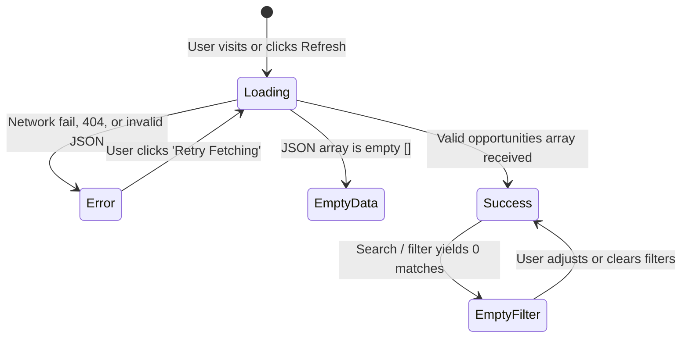

# Assignment 10: Fetch API & JSON — Campus Opportunity Explorer

**Course:** Web Technology Laboratory / Full-Stack Web Development  
**Institution:** MVPS's KBT College of Engineering (KBTCOE), Nashik  
**Academic Year:** 2025–2026  
**Module:** Assignment 10 (`10-Fetch_API_JSON`)  
**Platform Track:** KBTCOE Connect — The Professional Network for KBTCOE Students  

---

## 1. Aim

To design, develop, and verify an asynchronous **Campus Opportunity Explorer Module** for **KBTCOE Connect** using plain HTML5, CSS3, and vanilla JavaScript (ES6+), demonstrating the Fetch API, Promises, `async`/`await` syntax, HTTP status verification via `response.ok`, JSON data parsing and schema validation, defensive error recovery with an interactive Retry mechanism, safe DOM manipulation via `textContent`, and multi-criteria client-side search and filtering.

---

## 2. Learning Objectives

By completing this assignment, students will be able to:
1. Explain what an Application Programming Interface (API) is and how JSON (JavaScript Object Notation) formats data.
2. Utilize the modern `window.fetch()` API to initiate asynchronous HTTP `GET` requests.
3. Understand the mechanics of JavaScript Promises and manage asynchronous execution flow using `async` and `await`.
4. Distinguish between network transport success and HTTP protocol success by inspecting `response.ok` and `response.status`.
5. Parse streaming JSON payloads using `response.json()` and validate incoming data schemas.
6. Architect an asynchronous UI state machine managing **Loading**, **Success**, **Empty Data**, **Empty Filter**, and **Error** states.
7. Implement defensive error handling with `try...catch` and build an actionable "Retry" recovery workflow.
8. Understand browser security restrictions (Cross-Origin Resource Sharing / CORS) when loading local files over `file://` versus HTTP servers.

---

## 3. Theoretical Background

### 3.1 What is an API and What is JSON?

- **API (Application Programming Interface):** A set of defined rules, protocols, and endpoints that allows different software applications to communicate and exchange data. In web development, web APIs allow client browsers to request resources from servers or static JSON datastores.
- **JSON (JavaScript Object Notation):** A lightweight, text-based, language-independent data interchange format derived from JavaScript object syntax. JSON represents:
  - **Objects:** Collections of key-value pairs wrapped in curly braces `{ "key": "value" }`. Keys must be double-quoted strings.
  - **Arrays:** Ordered lists of values enclosed in square brackets `[ "val1", "val2" ]`.
  - **Supported Types:** String, Number, Boolean, Object, Array, and `null`.

---

### 3.2 The Fetch API & Promises

The **Fetch API** (`window.fetch()`) is the modern browser standard for making network requests, replacing the older, callback-heavy `XMLHttpRequest` (XHR) API.

A **Promise** represents the eventual completion (or failure) of an asynchronous operation and its resulting value. A Promise exists in one of three states:
1. **Pending:** Initial state; operation is still in progress.
2. **Fulfilled:** Operation completed successfully (resolved).
3. **Rejected:** Operation failed (rejected).

### 3.3 The `async` and `await` Paradigm

Introduced in ES2017, `async` and `await` provide syntactic sugar on top of Promises, allowing asynchronous code to be written and read like synchronous procedural code:

```javascript
async function loadOpportunities() {
  try {
    // Execution pauses until fetch() Promise resolves
    const response = await fetch('./data/opportunities.json');
    
    // Execution pauses until JSON parsing Promise resolves
    const data = await response.json();
    
    console.log(data);
  } catch (error) {
    console.error("Network or parsing failed:", error);
  }
}
```

---

### 3.4 Why Checking `response.ok` is Mandatory

> [!IMPORTANT]
> **A resolved `fetch()` Promise DOES NOT mean the HTTP request was successful!**

In the Fetch API specification:
- A `fetch()` Promise rejects **only on a network failure** (e.g., DNS resolution failure, network offline, connection refused).
- If the server responds with an HTTP error status—such as **`404 Not Found`**, **`403 Forbidden`**, or **`500 Internal Server Error`**—the `fetch()` Promise **still resolves successfully**!

Therefore, developers must always inspect the `response.ok` property:

```javascript
const response = await fetch(url);

// response.ok is true if response.status is between 200 and 299
if (!response.ok) {
  throw new Error(`HTTP Error ${response.status}: ${response.statusText}`);
}

const data = await response.json();
```

---

### 3.5 Asynchronous UI State Machine

To provide an optimal user experience, asynchronous applications must manage 5 distinct visual states:



1. **Loading State:** Displays an animated CSS spinner while waiting for network response.
2. **Success State:** Populates and displays the responsive opportunity cards grid.
3. **Empty Data State:** Rendered if the data source returns an empty array `[]`.
4. **Empty Filter State:** Rendered if user search/type criteria return 0 matching results, offering a "Reset All Filters" button.
5. **Error State:** Displays a clear warning alert detailing the specific error and provides a working **"🔄 Retry Fetching"** button.

---

### 3.6 Local Browser Execution & CORS (`file://` Protocol)

When opening an HTML file directly by double-clicking it in Windows File Explorer, the URL scheme is `file:///...`.

Most modern browsers (including Chrome, Firefox, and Edge) enforce security boundaries that prevent scripts from fetching local files via `file://`, throwing a `Cross-Origin Request Blocked (CORS)` or `TypeError: Failed to fetch`.

To run asynchronous Fetch practicals locally, the application **must be served via HTTP**:
```powershell
# Using Python's built-in web server:
python -m http.server 8000

# OR using Node.js npx:
npx serve .
```

`app.js` includes automated detection: if the page is opened on `file:`, a prominent guidance banner appears explaining how to launch a local server.

---

## 4. Project Folder Structure

```
assignments/10-Fetch_API_JSON/
├── index.html              # Semantic HTML5 layout, controls bar, and dynamic grid container
├── style.css               # Styling using KBTCOE palette, opportunity cards, and state cards
├── app.js                  # Asynchronous fetch engine, state machine, search/filter, and safe DOM renderer
├── kbtcoe-logo.svg         # Official college platform branding mark
├── README.md               # Laboratory manual and viva voce guide
└── data/
    └── opportunities.json  # Synthetic JSON dataset containing 9 opportunity records
```

---

## 5. Setup & Local Execution Guide

### 5.1 Starting a Local HTTP Server

Open PowerShell or Command Prompt and navigate to the Assignment 10 directory:

```powershell
cd "c:\Users\administrator.FABEXENG\Desktop\Projecy\assignments\10-Fetch_API_JSON"
```

Start a local server using either Python or Node:

**Option A (Python 3):**
```powershell
python -m http.server 8000
```

**Option B (Node.js):**
```powershell
npx.cmd serve . -p 8000
```

### 5.2 Opening in the Browser

Open your browser and navigate to:
```
http://localhost:8000/
```

---

## 6. Verification & Test Matrix

| Test Scenario | Action Performed | Expected Behavior |
| :--- | :--- | :--- |
| **Initial Load** | Load page over local HTTP server | Spinner briefly displays while fetching; cards grid appears showing all 9 opportunities. Summary bar reads: *"Showing 9 of 9 opportunities"*. |
| **Search by Keyword** | Type `"Python"` into search box | Grid filters in real time to show only opportunities tagged or mentioning Python. Count updates. |
| **Filter by Type** | Select `"Hackathon"` in dropdown | Grid displays only Hackathons (Smart Campus Hackathon & Smart City Sprint). |
| **Combined Filters** | Select `"Internship"` and type `"Cloud"` | Grid displays only Cloud Systems Summer Internship. Both filters work concurrently. |
| **Empty Search State** | Type `"xyz999nonexistent"` | Shows empty state: *"No Matching Opportunities Found"* with a "Reset All Filters" button. |
| **Reset Filters Action**| Click "Clear Filters" button | Search box clears, dropdown reverts to "All Opportunity Types", all 9 cards re-render. |
| **Refresh Opportunities**| Click "🔄 Refresh" button | Re-executes `fetch()`, disables button during load (`aria-busy="true"`), and re-renders data cleanly. |
| **Error Simulation** | Click "⚡ Simulate Error" button | Intentionally fetches a non-existent 404 endpoint. Displays red Error Card: *"Failed to Fetch Opportunities: HTTP Error 404"* with a functional **"🔄 Retry Fetching"** button. |
| **Error Recovery** | Click "🔄 Retry Fetching" on Error Card | Application re-fetches `./data/opportunities.json`, recovers from the error, and re-renders the 9 opportunity cards. |

---

## 7. Viva Voce Questions and In-Depth Answers

### Q1: What is the Fetch API, and how does it improve upon `XMLHttpRequest`?
**Answer:**
The Fetch API is a modern, native browser interface for making asynchronous HTTP requests. Unlike `XMLHttpRequest` (XHR), which relied on complex event callbacks and nested listeners, Fetch uses a Promise-based architecture. This allows cleaner asynchronous code, integration with `async`/`await`, better streaming control, and a unified `Request`/`Response` interface.

---

### Q2: Why does `fetch()` NOT reject its Promise on HTTP 404 or 500 error responses?
**Answer:**
The Promise returned by `fetch()` represents the completion of the network exchange. As long as the browser was able to contact the server and receive any HTTP response (even an error response like 404 Not Found or 500 Internal Server Error), the network operation succeeded. Therefore, the Promise resolves. It only rejects if there is a complete network failure (e.g. DNS failure, cable disconnected). Consequently, developers must manually verify `response.ok` to detect HTTP errors.

---

### Q3: What is the difference between `response.json()` and `JSON.parse()`?
**Answer:**
- `JSON.parse()` is a synchronous JavaScript function that takes an already completed string in memory and converts it into a JavaScript object.
- `response.json()` is an asynchronous method provided on the Fetch API `Response` object. Because HTTP responses arrive as a stream of bytes over the network, `response.json()` reads the response stream to completion and parses it into JSON, returning a Promise that resolves with the parsed data.

---

### Q4: Explain the difference between synchronous and asynchronous execution in JavaScript.
**Answer:**
- **Synchronous Execution:** JavaScript executes code sequentially on a single thread. Each line must complete before the next line can run. If a synchronous task takes time (e.g. a heavy loop), it blocks the entire browser thread, freezing the UI.
- **Asynchronous Execution:** Operations that require waiting (such as network requests or timers) are delegated to the browser runtime (Web APIs). JavaScript continues executing other code. When the asynchronous operation finishes, its callback or Promise resolution is placed in the task queue to run on the call stack, preventing UI freezes.

---

### Q5: What are `async` and `await`, and what do they return?
**Answer:**
`async` and `await` are language keywords that simplify working with Promises:
- An `async` function always returns a Promise. If the function returns a primitive value, JavaScript automatically wraps it in a resolved Promise.
- `await` can only be used inside an `async` function. It pauses function execution until the awaited Promise settles, unpacking the resolved value directly or throwing an exception if the Promise rejects.

---

### Q6: Why does opening a webpage using `file://` often block `fetch()`?
**Answer:**
Browsers implement the Same-Origin Policy (SOP) and Cross-Origin Resource Sharing (CORS) security mechanisms. Under the `file://` protocol, the origin is either `null` or opaque, depending on the browser. To prevent malicious HTML files saved on disk from reading arbitrary local files on the user's hard drive, browsers block `fetch()` and `XMLHttpRequest` requests when operating over the `file://` scheme. Serving files over HTTP (`http://localhost`) provides a valid origin.

---

### Q7: Why is `try...catch` essential when writing asynchronous `await` code?
**Answer:**
When using `await`, a rejected Promise throws an exception at the point of the `await` statement. If an `await` call is not enclosed in a `try...catch` block, the exception becomes an "Unhandled Promise Rejection," which halts the current function, logs an error to the browser console, and leaves the user interface stuck in a loading or broken state. `try...catch` allows developers to gracefully catch network or parsing errors and update the UI with a helpful error message.

---

### Q8: What is defensive data validation, and why is it necessary after parsing JSON?
**Answer:**
Defensive validation is the practice of verifying that external data adheres to expected types and structures before using it in application logic. Even if `response.json()` parses without throwing a syntax error, the returned data might be an unexpected shape (e.g. an error object `{ "error": "rate limited" }` instead of an array). Validating `Array.isArray(data)` and checking required object fields prevents downstream `TypeError: Cannot read properties of undefined` crashes.

---

### Q9: How does using `document.createElement()` and `textContent` protect against Cross-Site Scripting (XSS)?
**Answer:**
If opportunity descriptions or titles originate from an external API or user submissions, malicious actors could inject HTML tags like `<script>` or ``. Setting `element.textContent` instructs the browser to treat the input strictly as literal character text, disabling HTML parsing. In contrast, assigning to `element.innerHTML` would parse and execute any malicious script tags.

---

### Q10: What is the difference between consuming a static local JSON file versus a dynamic REST API endpoint?
**Answer:**
- **Static Local JSON File:** The file resides on the web server as a fixed document (`/data/opportunities.json`). It supports only read operations (`GET`), returns the exact same data to all users, and cannot perform server-side filtering, sorting, or authentication.
- **Dynamic REST API Endpoint:** The endpoint is handled by a backend server (e.g. Node/Express, PHP, Python). It can interact with a database, accept query parameters (`/api/opportunities?type=internship`), enforce user authentication, and support write operations (`POST`, `PUT`, `DELETE`).

---

### Q11: Explain how the "Retry" button functions in error handling.
**Answer:**
In our implementation, when an error occurs during `loadOpportunities()`, the catch block updates state to `fetchStatus = "error"`. The rendering engine creates an Error Card containing a button with an event listener attached to `loadOpportunities()`. When clicked, this button triggers the exact same fetch function again, transitioning state back to `"loading"` and giving the user an intuitive way to recover from temporary network drops without refreshing the page.

---

### Q12: Why is the `aria-live="polite"` attribute used on the opportunities grid container?
**Answer:**
`aria-live="polite"` is an accessibility attribute that notifies screen readers when the contents of an element update dynamically. When new opportunity cards load or when a search filter changes the results, the screen reader announces the changes to visually impaired users at the next available pause without rudely interrupting their current speech.

---

## 8. Conclusion

Assignment 10 successfully establishes the asynchronous data-fetching foundation for KBTCOE Connect. By implementing the native Fetch API, `async`/`await`, HTTP status verification, defensive JSON validation, accessible state indicators, and safe DOM construction, the Opportunity Explorer functions as a robust, resilient client-side module prepared for future dynamic REST API backend integration.
