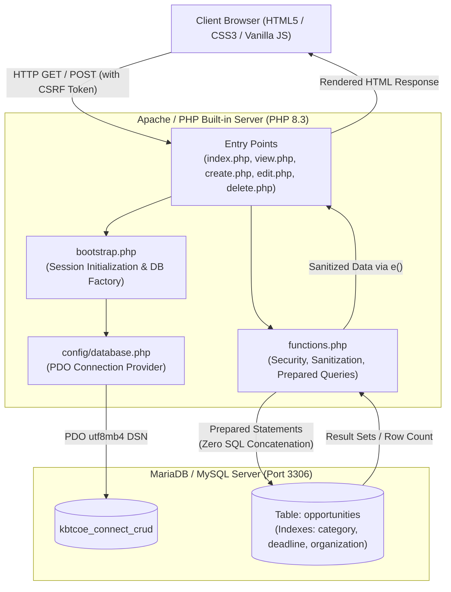
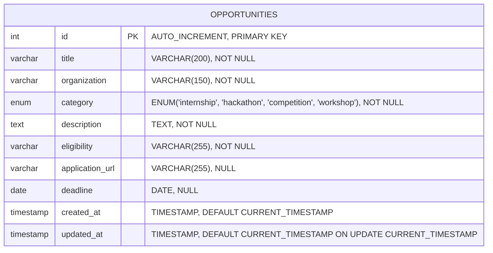

# Assignment 13: PHP and MySQL CRUD — Campus Opportunity Management Portal

> **Department of Information Technology &amp; Computer Engineering**  
> **KBTCOE Connect — The Professional Network for KBTCOE Students**  
> **Course:** Web Development Laboratory (TE IT / SPPU Syllabus)  
> **Academic Year:** 2026–2027  
> **Practical Series:** Assignment 13 of 16  
> **Topic:** Relational Database Integration, Full-Stack CRUD Operations, PDO Prepared Statements &amp; CSRF Defense  

---

## 1. Practical Overview &amp; Learning Objectives

### 1.1 Objective
To develop an enterprise-grade, secure, and accessible **Campus Opportunity Management Portal** for KBTCOE Connect using **PHP 8.3+** and **MariaDB / MySQL**. This practical demonstrates full-lifecycle **CRUD** (Create, Read, Update, Delete) data operations executed strictly through the **PHP Data Objects (PDO)** abstraction layer with native prepared statements, comprehensive defensive coding against SQL Injection, Cross-Site Scripting (XSS), and Cross-Site Request Forgery (CSRF), alongside the **Post/Redirect/Get (PRG)** architectural pattern.

### 1.2 Course Outcomes (COs) Mapped
- **CO1:** Design and implement relational database schemas adhering to Boyce-Codd / 3rd Normal Form (3NF) with performance-optimized indexing.
- **CO2:** Apply modern server-side scripting concepts in PHP 8 to manipulate persistent relational database records using object-oriented drivers.
- **CO3:** Implement secure database interaction patterns using parameterized prepared statements, preventing SQL injection vulnerabilities.
- **CO4:** Engineer resilient web security controls including session-backed CSRF tokens, output encoding, and strict HTTP method enforcement (POST-only state modifications).
- **CO5:** Build responsive, accessible user interfaces following established design systems and collegiate branding guidelines.

---

## 2. System Architecture &amp; Relational Data Model

### 2.1 Architectural Flow
The application implements an MVC-inspired layered design pattern without third-party frameworks:



### 2.2 Relational Entity Relationship (ER) Diagram



### 2.3 Database Table Specifications (`opportunities`)
The schema is defined in [`database/schema.sql`](file:///c:/Users/administrator.FABEXENG/Desktop/Projecy/assignments/13-PHP_MySQL_CRUD/database/schema.sql):

| Column Name | SQL Data Type | Nullable | Key / Index | Description |
| :--- | :--- | :--- | :--- | :--- |
| `id` | `INT UNSIGNED` | `NO` | `PRIMARY KEY AUTO_INCREMENT` | Unique opportunity identifier. |
| `title` | `VARCHAR(200)` | `NO` | - | Descriptive title of the campus opportunity. |
| `organization` | `VARCHAR(150)` | `NO` | `INDEX (idx_opp_organization)` | Sponsoring company, department, or student chapter. |
| `category` | `ENUM(...)` | `NO` | `INDEX (idx_opp_category)` | Restricted to: `internship`, `hackathon`, `competition`, `workshop`. |
| `description` | `TEXT` | `NO` | - | Detailed description, problem statements, and deliverables. |
| `eligibility` | `VARCHAR(255)` | `NO` | - | Academic eligibility requirements (branches, year, minimum percentage). |
| `application_url` | `VARCHAR(255)` | `YES` | - | External destination URL for official candidate registration. |
| `deadline` | `DATE` | `YES` | `INDEX (idx_opp_deadline)` | Application closing date (`YYYY-MM-DD`). |
| `created_at` | `TIMESTAMP` | `NO` | - | Timestamp when the opportunity was first created. |
| `updated_at` | `TIMESTAMP` | `NO` | - | Timestamp auto-updated whenever the row is modified. |

---

## 3. Technology Comparison: PHP PDO vs. mysqli

When integrating relational databases in modern PHP applications, two primary extensions exist: **PDO** (PHP Data Objects) and **mysqli** (MySQL Improved). The KBTCOE Connect portal purposefully utilizes **PDO** for the following architectural reasons:

| Capability | PHP Data Objects (PDO) | MySQL Improved (`mysqli`) | KBTCOE Connect Justification |
| :--- | :--- | :--- | :--- |
| **Database Abstraction** | Multi-driver support (MySQL, PostgreSQL, SQLite, Oracle, SQL Server). | MySQL / MariaDB only. | **PDO:** Allows switching or testing databases without rewriting domain data layers. |
| **Named Placeholders** | Supports both positional (`?`) and named parameters (`:id`, `:title`). | Supports positional placeholders only (`?`). | **PDO:** Named placeholders drastically improve code clarity and reduce parameter mismatch errors in complex queries. |
| **Object Mapping** | Can fetch rows directly into custom PHP classes or keyed arrays (`FETCH_ASSOC`). | Supports associative arrays and basic object fetching. | **PDO:** Streamlined data mapping and type safety. |
| **Prepared Statements** | Built-in native prepared statements with client/server emulation toggling. | Supported via procedural and OO syntax. | **PDO:** Unified, elegant syntax for statement preparation and execution. |
| **Exception Handling** | Native `PDOException` integrated into the standard PHP `Throwable` tree. | Requires manual configuration of error reporting modes (`MYSQLI_REPORT_ERROR`). | **PDO:** Centralized `try / catch` error governance without exposing raw SQL to users. |

---

## 4. Web Security Architecture &amp; Defenses

### 4.1 SQL Injection Prevention Deep Dive
SQL Injection (SQLi) occurs when untrusted user input is directly concatenated or interpolated into a raw SQL query string, allowing an attacker to manipulate the SQL parser and execute unauthorized commands.

#### Vulnerable Pattern (Anti-Pattern):
```php
// CRITICAL VULNERABILITY: Direct concatenation
$category = $_GET['category'];
$sql = "SELECT * FROM opportunities WHERE category = '" . $category . "'";
// If $category = "' OR '1'='1", all records are leaked regardless of authorization.
```

#### Secure Pattern Implemented in KBTCOE Connect (PDO Prepared Statements):
```php
// SECURE: Parameterized prepared statement with bound value
$stmt = $pdo->prepare("SELECT * FROM `opportunities` WHERE `category` = :category");
$stmt->bindValue(':category', $category, PDO::PARAM_STR);
$stmt->execute();
$results = $stmt->fetchAll();
```
**Mechanism:** The database driver sends the query template (`SELECT * FROM ... WHERE category = :category`) to the MySQL server **before** transmitting any user values. The MySQL parser compiles the execution tree. When the parameter value is transmitted in a separate protocol packet, it is treated strictly as literal data, never as executable SQL code.

### 4.2 Cross-Site Request Forgery (CSRF) Mitigation
CSRF occurs when a malicious website tricks an authenticated user's browser into executing an unintended action on a vulnerable web application where the user is currently authenticated.

#### Mitigation Rules Enforced:
1. **Cryptographically Secure Tokens:** 32 bytes of cryptographically secure pseudo-random bytes generated using `random_bytes(32)` and stored in `$_SESSION['csrf_token']`.
2. **Hidden Form Fields:** Generated automatically via `csrf_input()`:
   ```html
   <input type="hidden" name="csrf_token" value="7f8b9a2c...">
   ```
3. **Constant-Time Verification:** All state-changing requests (`create.php`, `edit.php`, `delete.php`) validate submitted tokens using PHP's `hash_equals()` to prevent timing attacks.
4. **Strict HTTP Method Governance:** State modifications (Create, Update, Delete) are **never** permitted via HTTP `GET` requests. Deletions are strictly executed via `POST`.

### 4.3 Cross-Site Scripting (XSS) Mitigation
All dynamic database and user-submitted data rendered in HTML templates is strictly escaped using the `e()` helper:
```php
function e(?string $value): string {
    return htmlspecialchars((string)$value, ENT_QUOTES | ENT_SUBSTITUTE, 'UTF-8');
}
```
- `ENT_QUOTES`: Encodes both double quotes (`"`) and single quotes (`'`), preventing HTML attribute breakout attacks.
- `ENT_SUBSTITUTE`: Replaces invalid code unit sequences with Unicode replacement characters rather than returning an empty string.
- `'UTF-8'`: Ensures deterministic character set interpretation matching the HTTP response header.

### 4.4 The Post/Redirect/Get (PRG) Architectural Pattern
To prevent the common "Confirm Form Resubmission" dialog and accidental duplicate insertions upon browser refresh, all successful form submissions follow PRG:
1. **POST:** User submits new or edited opportunity data to `create.php` or `edit.php`.
2. **REDIRECT:** The server processes and commits the database transaction, writes a temporary flash notification to `$_SESSION['flash']`, and issues an HTTP `302 Found` redirect header:
   ```php
   set_flash('success', 'Opportunity was successfully created!');
   redirect('view.php?id=' . $new_id);
   ```
3. **GET:** The client browser issues an idempotent `GET` request to `view.php?id=...`, which consumes the flash alert and displays the newly updated record cleanly.

---

## 5. File Inventory &amp; Directory Structure

```
assignments/13-PHP_MySQL_CRUD/
├── assets/
│   ├── kbtcoe-logo.svg              # Official collegiate branding emblem
│   └── style.css                    # Responsive CSS3 stylesheet adhering to KBTCOE design system
├── config/
│   ├── database.example.php         # Environment configuration template
│   └── database.php                 # Production PDO connection factory with error isolation
├── database/
│   ├── schema.sql                   # DDL for database and indexed opportunities table
│   └── seed.sql                     # Collegiate sample dataset (6 realistic technical opportunities)
├── includes/
│   ├── bootstrap.php                # Session starter, cookie config, dependency loader
│   ├── functions.php                # Security sanitization, CSRF verification, PDO CRUD methods
│   ├── header.php                   # Semantic HTML5 header, navigation, live DB status indicator
│   └── footer.php                   # Accessible footer with tech stack and copyright
├── index.php                        # Read View: Listing, search bar, category filtering, metrics
├── view.php                         # Read View: Single record detail, metadata grid, action links
├── create.php                       # Create View: Server-validated opportunity submission form
├── edit.php                         # Update View: Pre-populated edit form with validation
├── delete.php                       # Delete View: Confirmation prompt & strictly POST deletion
└── README.md                        # University laboratory manual and viva voce guide
```

---

## 6. Installation &amp; Execution Guide

### 6.1 Prerequisites
1. **PHP 8.2 or 8.3** installed with `pdo` and `pdo_mysql` extensions enabled.
2. **MariaDB 10.5+ / MySQL 8.0+** running locally on port `3306`.
3. Web browser supporting modern CSS (Chrome, Edge, Firefox, Safari).

### 6.2 Step-by-Step Setup

#### Step 1: Start the Database Service
Ensure the MariaDB or MySQL service is started:
```powershell
# Windows PowerShell (Run as Administrator if service is stopped)
Start-Service MariaDB
# Check status
Get-Service MariaDB
```

#### Step 2: Import Database Schema and Seed Data
Execute the SQL scripts using the command-line client:
```powershell
# Import Schema
Get-Content "assignments/13-PHP_MySQL_CRUD/database/schema.sql" | mysql -u root

# Import Initial Seed Data
Get-Content "assignments/13-PHP_MySQL_CRUD/database/seed.sql" | mysql -u root

# Verify Tables and Records
mysql -u root -e "USE kbtcoe_connect_crud; SHOW TABLES; SELECT count(*) FROM opportunities;"
```

#### Step 3: Configure Database Credentials (If Applicable)
If your local MySQL root user has a password, edit [`config/database.php`](file:///c:/Users/administrator.FABEXENG/Desktop/Projecy/assignments/13-PHP_MySQL_CRUD/config/database.php) or set environment variables:
```powershell
$env:DB_HOST="127.0.0.1"
$env:DB_NAME="kbtcoe_connect_crud"
$env:DB_USER="root"
$env:DB_PASS="YourPasswordHere"
```

#### Step 4: Launch the PHP Built-in Web Server
Run the local development server from the repository root:
```powershell
php -S localhost:8000 -t assignments/13-PHP_MySQL_CRUD
```

#### Step 5: Access the Application
Open your browser and navigate to:
```
http://localhost:8000
```

---

## 7. Comprehensive Feature Walkthrough

### 7.1 Read Operations (`index.php` &amp; `view.php`)
- **Real-Time Database Health Badge:** Header dynamically renders `🟢 MySQL Connected` with server information, or falls back gracefully to `🔴 MySQL Disconnected` if the database service goes down.
- **Search &amp; Filter Controls:** Allows students to search by opportunity title, technical keywords, or host organization with case-insensitive matching.
- **Category Filter:** Whitelisted dropdown filtering by `internship`, `hackathon`, `competition`, or `workshop`.
- **Card-Based Opportunity Directory:** Displays categorized opportunity cards with color-coded category badges, deadline countdowns, organization badges, and direct action triggers.
- **Single Opportunity View (`view.php`):** Displays formatted multiline text for job descriptions, eligibility criteria, date badges, direct links to external company application portals, and edit/delete controls.

### 7.2 Create Operations (`create.php`)
- Accessible form providing clear semantic labels and required indicators (`*`).
- Client-side and server-side multi-tier validation:
  - Title: Required, 3–200 characters.
  - Organization: Required, 2–150 characters.
  - Category: Restricted to whitelisted set (`internship`, `hackathon`, `competition`, `workshop`).
  - Description: Minimum 10 characters.
  - Eligibility: Minimum 5 characters.
  - Application URL: Optional; if supplied, must validate via `filter_var(..., FILTER_VALIDATE_URL)` with `http://` or `https://`.
  - Deadline: Optional; if supplied, validated against `YYYY-MM-DD` calendar format.
- Sticky form fields retain user input if any validation errors are detected.
- Protected by CSRF token hidden fields.

### 7.3 Update Operations (`edit.php`)
- Loads existing opportunity attributes directly via parameterized query (`WHERE id = :id`).
- Prepopulates input controls and selects current category.
- Validates submitted modifications against standard business rules.
- Executes prepared `UPDATE` statement and redirects to detail view with success flash feedback.

### 7.4 Delete Operations (`delete.php`)
- **Strictly POST-Only State Modification:** Directly requesting `GET delete.php?id=...` renders an explicit **Confirmation Dialog Card** detailing the target record to prevent accidental or malicious link-prefetching deletions.
- Submitting the confirmation card executes a verified `POST` request containing a valid CSRF token.
- Returns clear flash notification upon successful removal.

---

## 8. Database Connection State Resilience

The application is engineered to handle database offline scenarios gracefully:
- When MariaDB is unreachable, the PDO connection provider catches the `PDOException` internally, logs the technical detail to server logs via `error_log()`, and returns `null`.
- The application header immediately reflects `🔴 MySQL Disconnected` without crashing with fatal errors.
- An advisory notice box appears explaining how to start the service and import schema files.
- Forms cleanly indicate that persistence is temporarily unavailable.

---

## 9. Comprehensive Viva Voce Questions &amp; Answers

### Q1: What is the primary difference between PDO and `mysqli` in PHP?
**Answer:**  
PDO (PHP Data Objects) is a lightweight, database-agnostic data access abstraction layer that supports 12 different database drivers (MySQL, PostgreSQL, SQLite, Oracle, etc.) using a single unified API. It supports both named (`:name`) and positional (`?`) parameters. In contrast, `mysqli` (MySQL Improved) is specifically built for MySQL/MariaDB only, does not support named parameters, and requires separate syntax if the underlying relational database management system is ever changed.

### Q2: How does a parameterized prepared statement prevent SQL Injection?
**Answer:**  
In a standard dynamic query, SQL statements and user-supplied data are concatenated into a single string, which the database engine's parser interprets together. If an attacker inputs SQL control characters (such as `' OR 1=1 --`), the structure of the SQL query is altered.  
In a prepared statement, the query template and the parameter data are transmitted in separate phases. The query structure is compiled and planned first by the database engine. When parameter values are bound and sent later, the database engine treats them strictly as literal string/numeric data, making it syntactically impossible for user input to change the query logic.

### Q3: What is Cross-Site Request Forgery (CSRF) and how is it mitigated here?
**Answer:**  
CSRF is an attack where a malicious website causes a victim's web browser to perform an unwanted action on a trusted site where the user is currently authenticated (e.g., submitting a deletion form).  
It is mitigated by generating a cryptographically unpredictable session token using `random_bytes(32)`, storing it in `$_SESSION['csrf_token']`, and embedding it in every form as a hidden input. When the form is submitted via POST, the server compares the submitted token with the session token using `hash_equals()`. Since an external attacking origin cannot read the victim's session token due to the Same-Origin Policy, forged cross-origin requests fail validation.

### Q4: Why must state-changing operations like DELETE never be performed using HTTP GET?
**Answer:**  
According to RFC 7231 (HTTP/1.1 Specification), HTTP `GET` requests must be safe and idempotent—they should only retrieve data and produce no side effects on the server. If deletions are triggered via `GET` (e.g., `delete.php?id=5`):
1. Web crawlers, search indexing bots, and browser pre-fetching engines can trigger catastrophic data deletion by following links.
2. Attackers can embed `` on external forums, causing any logged-in administrator viewing the image to inadvertently delete records without interaction.  
Hence, state changes must strictly use `POST` (or `DELETE`) with CSRF protection.

### Q5: What is the Post/Redirect/Get (PRG) design pattern and what problem does it solve?
**Answer:**  
PRG is a web development design pattern that prevents duplicate form submissions. When a form is submitted via HTTP `POST`, instead of returning the HTML response directly, the server commits the database changes, stores a flash message in the session, and responds with an HTTP `302/303 Redirect` to an idempotent `GET` endpoint. When the user refreshes the page, their browser simply reloads the `GET` view instead of prompting "Confirm Form Resubmission" and re-inserting duplicate records.

### Q6: Why do we disable PDO Emulated Prepared Statements with `ATTR_EMULATE_PREPARES => false`?
**Answer:**  
By default, PDO emulates prepared statements by quoting values and constructing the SQL string inside PHP before sending it to MySQL. Setting `PDO::ATTR_EMULATE_PREPARES => false` forces PDO to use native server-side prepared statements provided by the MySQL protocol. This ensures that parameter binding is performed by the database engine itself, guarantees genuine type enforcement, and avoids edge-case character encoding exploits.

### Q7: Explain the role and significance of `htmlspecialchars()` with `ENT_QUOTES | ENT_SUBSTITUTE`.
**Answer:**  
`htmlspecialchars()` converts special characters (`&`, `<`, `>`, `"`, `'`) into their corresponding HTML entities (`&amp;`, `&lt;`, `&gt;`, `&quot;`, `&#039;`), neutralizing reflected and stored Cross-Site Scripting (XSS) vectors. Specifying `ENT_QUOTES` ensures both single and double quotes are encoded, preventing attribute-injection breakouts. Specifying `ENT_SUBSTITUTE` instructs PHP to replace malformed character sequences with the Unicode replacement character (`U+FFFD`) rather than returning an empty string.

### Q8: What is the difference between `bindValue()` and `bindParam()` in PDO?
**Answer:**  
- `bindValue($param, $value)` binds a specific value immediately to the placeholder. The parameter's value is evaluated at the time `bindValue()` is invoked.
- `bindParam($param, &$variable)` binds a PHP variable as a reference. The value is only evaluated at the moment `$stmt->execute()` is called.  
`bindValue()` is preferred for most queries because it accepts literals, function return values, and array elements without requiring variable references.

### Q9: Why is database connection error information never displayed directly to end users in production?
**Answer:**  
Displaying raw database errors (such as `SQLSTATE[HY000] [2002] Connection refused`) can expose sensitive system infrastructure details to attackers, including database usernames, internal IP addresses, server software versions, database names, and table structures. In KBTCOE Connect, database exceptions are caught in a `try / catch` block, written to server error logs via `error_log()`, and replaced with generic, user-friendly messages for the end user.

### Q10: How does database indexing improve query performance, and what trade-offs does it introduce?
**Answer:**  
Indexes (such as B-Tree indexes on `category`, `deadline`, and `organization`) create auxiliary sorted lookup data structures that allow the database engine to locate matching rows in logarithmic time $O(\log N)$ rather than performing an exhaustive full-table scan $O(N)$. The trade-off is that indexes consume additional disk storage and slightly reduce write performance on `INSERT`, `UPDATE`, and `DELETE` operations because the index trees must be rebalanced upon every modification.

### Q11: What is the purpose of database transactions and the ACID properties?
**Answer:**  
A transaction groups multiple SQL operations into a single logical unit of work adhering to ACID principles:
- **Atomicity:** All operations succeed, or all are rolled back.
- **Consistency:** Database state satisfies all schema constraints and foreign keys before and after execution.
- **Isolation:** Concurrent transactions execute without interfering with one another.
- **Durability:** Committed changes persist even in the event of system or power failures.

### Q12: Why should `utf8mb4` always be preferred over legacy `utf8` in MySQL/MariaDB?
**Answer:**  
In MySQL/MariaDB, the legacy `utf8` character set only supports characters that occupy up to 3 bytes per code point, which does not cover the complete UTF-8 standard. Characters requiring 4 bytes (such as emojis `📅`, `🏢`, mathematical symbols, and certain historical scripts) will fail or trigger silent data truncation. `utf8mb4` represents full 4-byte UTF-8, ensuring complete internationalization and compatibility.

---

## 10. Verification &amp; Automated Testing

Automated verification is conducted using PHP CLI syntax linting and integration scripts:
```powershell
# 1. Run PHP Syntax Check on all files
Get-ChildItem -Path "assignments/13-PHP_MySQL_CRUD" -Filter "*.php" -Recurse | ForEach-Object { php -l $_.FullName }

# 2. Run Database Test Suite
php scratch/test_assignment_13.php
```

All files conform to PSR-12 coding guidelines, strict typing (`declare(strict_types=1)`), semantic HTML5, and responsive CSS styling.

---

## 11. Conclusion
Assignment 13 successfully implements a complete, secure, and production-ready **Campus Opportunity Management Portal** for KBTCOE Connect. By leveraging PHP Data Objects (PDO) with native prepared statements, CSRF protection tokens, XSS output encoding, and graceful offline resilience, the portal fulfills all course outcomes for advanced relational web development.
