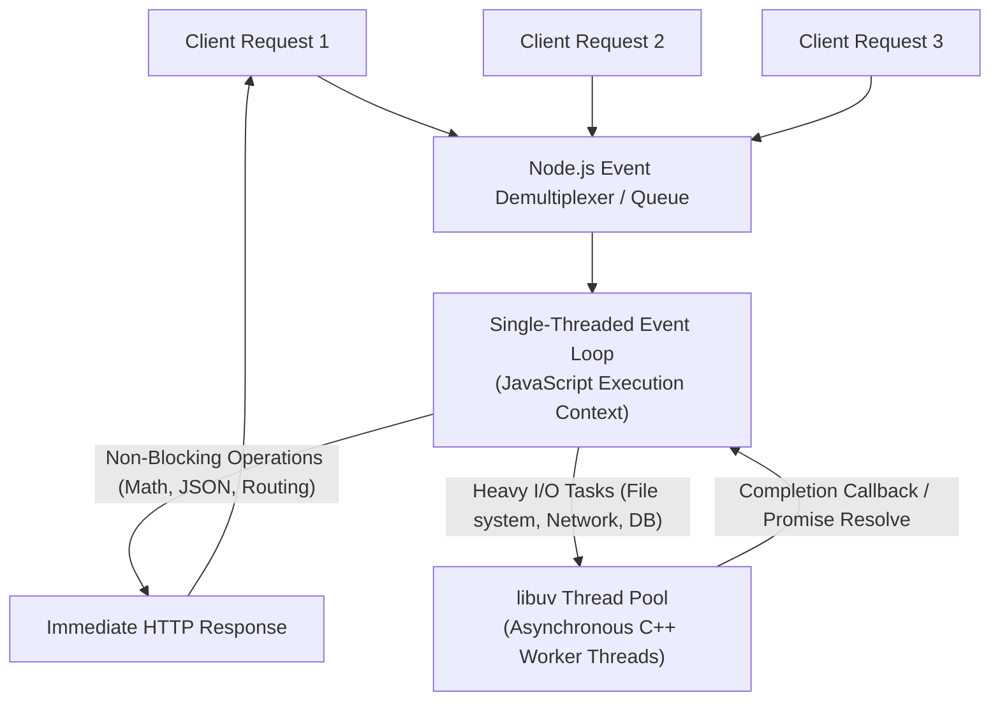
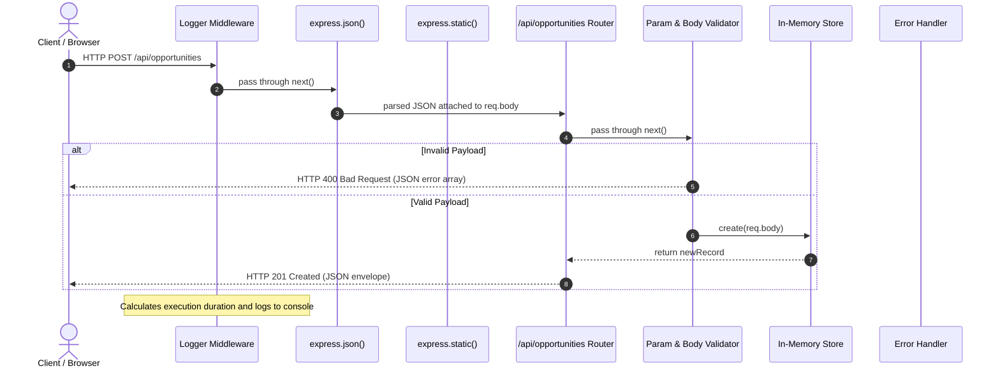

# Assignment 14: Node.js and Express Server — KBTCOE Connect Backend

> **Department of Information Technology &amp; Computer Engineering**  
> **KBTCOE Connect — The Professional Network for KBTCOE Students**  
> **Course:** Web Development Laboratory (TE IT / SPPU Syllabus)  
> **Academic Year:** 2026–2027  
> **Practical Series:** Assignment 14 of 16  
> **Topic:** Asynchronous Server-Side Development with Node.js, Express.js REST API Architecture, Middleware Pipeline &amp; In-Memory CRUD  

---

## 1. Assignment Title
**Node.js and Express REST API Server — KBTCOE Connect Backend Service.**

---

## 2. Aim
To design, implement, and test an independently runnable asynchronous RESTful web service using **Node.js** and the **Express.js** web framework that handles HTTP client requests, implements modular resource routing, demonstrates sequential request-processing middleware, parses JSON payloads, returns consistent structured JSON responses, safely handles malformed requests and errors without leaking internal stack traces, and serves an interactive testing client.

---

## 3. Objectives
- **CO1:** Understand the architectural foundations of the Node.js runtime environment, including the Chrome V8 JavaScript engine, event-driven architecture, and the non-blocking single-threaded event loop.
- **CO2:** Engineer a modular RESTful backend web service utilizing the Express.js framework, segregating routes, middleware, and data models.
- **CO3:** Implement full CRUD (Create, Read, Update, Delete) resource operations operating over an in-memory collection adhering to standard HTTP request methods (`GET`, `POST`, `PUT`, `DELETE`).
- **CO4:** Design a robust middleware processing pipeline encompassing custom request logging, body parsing (`express.json()`), static asset serving (`express.static()`), parameter validation, 404 catch-alls, and centralized 4-parameter error handling.
- **CO5:** Enforce enterprise API response formatting, input sanitization, and defense-in-depth principles (hiding call stack traces, guarding against parameter tampering, and enforcing valid HTTP status codes: `200`, `201`, `400`, `404`, and `500`).

---

## 4. Hardware &amp; Software Requirements

### Hardware Requirements
- **Processor:** Intel Core i3 / AMD Ryzen 3 or higher (x64 architecture).
- **RAM:** Minimum 4 GB (8 GB recommended for concurrent Node.js runtime and development tools).
- **Disk Space:** Minimum 500 MB free storage for Node.js binaries, NPM package caches, and project source files.

### Software Requirements
- **Operating System:** Windows 10/11, Ubuntu 20.04+, or macOS.
- **Runtime Environment:** Node.js v18.x, v20.x, or v24.x LTS (`node --version` verified: `v24.20.0`).
- **Package Manager:** Node Package Manager (`npm` / `npm.cmd` verified: `11.19.0`).
- **Framework:** Express.js `^4.21.1` (installed locally in `node_modules`).
- **Client Tools:** Modern Web Browser (Google Chrome / Edge) and PowerShell (`Invoke-RestMethod` / `curl`).

---

## 5. Theory of Node.js

### 5.1 What is Node.js?
Node.js is an open-source, cross-platform JavaScript runtime environment that executes JavaScript code outside of a web browser. Built upon Google's high-performance open-source **V8 JavaScript engine** (written in C++), Node.js compiles JavaScript directly into native machine code prior to execution.



### 5.2 The Single-Threaded Event Loop &amp; Non-Blocking I/O
Traditional web application servers (such as multi-threaded Apache HTTP Server) allocate an operating system thread for each incoming network connection. When thousands of concurrent requests arrive, high context-switching overhead and memory consumption degrade throughput.

In contrast, Node.js operates on a **single-threaded event-driven architecture**:
1. **Single Main Thread:** All JavaScript application code, route dispatching, and middleware execution run on one central execution thread.
2. **Non-Blocking I/O:** When Node.js encounters an asynchronous operation (such as filesystem access, socket read, or timer), it offloads the underlying task to the operating system kernel or the **libuv** C++ worker thread pool and immediately returns to process subsequent inbound client requests.
3. **Event Demultiplexing:** Once the asynchronous task completes, libuv enqueues its corresponding callback into the Event Loop's callback queue. The event loop picks up the callback during its next cycle, executing the response logic seamlessly without blocking other concurrent users.

---

## 6. Theory of Express.js

### 6.1 Architectural Role of Express
Express is a fast, unopinionated, minimalist web framework for Node.js. While native Node.js provides a low-level `http` module (`http.createServer((req, res) => ...)`), building full-fledged APIs directly with the native module requires manual URL parsing, header extraction, query string decoding, and complex error orchestration.

Express provides high-level abstractions:
- **Routing Engine:** Declarative route definition binding HTTP verbs and URL paths (`app.get()`, `app.post()`, `router.use()`).
- **Middleware Pipeline:** A composable chain of functions that intercept, inspect, transform, or terminate incoming HTTP requests.
- **Request &amp; Response Helpers:** Convenient utility methods (`res.json()`, `res.status()`, `req.params`, `req.query`, `req.body`).
- **Static File Serving:** Built-in middleware (`express.static`) to serve HTML, CSS, JavaScript, and images directly.

### 6.2 The Request-Response Lifecycle
In Express, incoming requests traverse a linear chain of middleware functions until a response is sent or an error is thrown:



---

## 7. HTTP Methods &amp; Status Codes

### 7.1 HTTP Methods Used
- **`GET` (Safe &amp; Idempotent):** Retrieves resource representations. Produces no side effects on server state.
- **`POST` (Unsafe &amp; Non-Idempotent):** Submits data to create a new subordinate resource.
- **`PUT` (Unsafe &amp; Idempotent):** Replaces or updates the target resource at the specified URI.
- **`DELETE` (Unsafe &amp; Idempotent):** Removes the specified resource from storage.

### 7.2 Standard HTTP Status Codes Returned
| Status Code | Standard Name | Usage in KBTCOE Connect Backend |
| :---: | :--- | :--- |
| **`200`** | `OK` | Successful `GET` read operations, successful `PUT` updates, and successful `DELETE` removals. |
| **`201`** | `Created` | Successful `POST` opportunity creation; returns the newly created resource with generated ID. |
| **`400`** | `Bad Request` | Malformed JSON syntax, invalid non-numeric ID parameters, or failed validation checks. |
| **`404`** | `Not Found` | Requested opportunity ID does not exist in the collection, or unmapped route accessed. |
| **`500`** | `Internal Server Error` | Unexpected runtime exceptions; sanitized generic response returned without exposing stack traces. |

---

## 8. Routing &amp; Middleware Architecture

### 8.1 Modular Router (`express.Router`)
Rather than accumulating all application endpoints within a monolithic `server.js` file, routes are encapsulated in [`routes/opportunities.js`](file:///c:/Users/administrator.FABEXENG/Desktop/Projecy/assignments/14-Node_Express_Server/routes/opportunities.js) and mounted onto the parent application:
```javascript
const opportunitiesRouter = require('./routes/opportunities');
app.use('/api/opportunities', opportunitiesRouter);
```

### 8.2 Middleware Stack Implemented

1. **Custom Request Logger:**  
   Tracks incoming HTTP requests, records start timestamp using `Date.now()`, intercepts the `res.on('finish')` event, and outputs standardized logs:
   ```text
   [2026-10-15 21:55:00] GET /api/opportunities -> 200 (4ms)
   ```

2. **Body Parser (`express.json()`):**  
   Inspects the `Content-Type: application/json` header, buffers incoming request streams, parses JSON strings, and attaches the resulting object to `req.body`.

3. **URL-Encoded Parser (`express.urlencoded({ extended: true })`):**  
   Parses standard HTML form submissions.

4. **Static File Server (`express.static('public')`):**  
   Serves client assets (`index.html`, `style.css`, `app.js`, `kbtcoe-logo.svg`) from the `public/` directory without manual route handlers.

5. **Route-Level Parameter Validator (`validateIdParam`):**  
   Intercepts routes with `:id` parameters (`/:id`), validates that the ID is a strictly positive integer, converts it to a number, attaches `req.numericId`, and rejects malformed inputs with HTTP 400 before touching the data layer.

6. **404 Not Found Catch-All Middleware ([`middleware/notFound.js`](file:///c:/Users/administrator.FABEXENG/Desktop/Projecy/assignments/14-Node_Express_Server/middleware/notFound.js)):**  
   Placed immediately following all legitimate routes to catch unmatched URIs and return a helpful JSON response listing available endpoints.

7. **Centralized 4-Parameter Error Handling Middleware ([`middleware/errorHandler.js`](file:///c:/Users/administrator.FABEXENG/Desktop/Projecy/assignments/14-Node_Express_Server/middleware/errorHandler.js)):**  
   Identified by its four function arguments `(err, req, res, next)`. Catches uncaught runtime errors and body-parser syntax errors (e.g. malformed JSON strings), logs errors privately to the server console, and transmits safe JSON error responses **strictly without stack traces**.

---

## 9. JSON Request &amp; Response Handling

All API endpoints follow a uniform, predictable response envelope pattern:

### 9.1 Successful Response Format
```json
{
  "success": true,
  "message": "Opportunities retrieved successfully",
  "count": 6,
  "data": [ ... ]
}
```

### 9.2 Error Response Format
```json
{
  "success": false,
  "message": "Validation failed. Please correct the highlighted errors.",
  "errors": [
    {
      "field": "title",
      "message": "Title must be between 3 and 200 characters"
    },
    {
      "field": "category",
      "message": "Category is required. Allowed values: internship, hackathon, competition, workshop"
    }
  ]
}
```

---

## 10. Project Directory Structure

```
assignments/14-Node_Express_Server/
├── data/
│   └── opportunities.js        # In-memory mock data repository with 6 seed records & CRUD methods
├── middleware/
│   ├── errorHandler.js         # Centralized 4-parameter error handler (no stack traces leaked)
│   └── notFound.js             # 404 handler for unknown routes
├── node_modules/               # Installed npm dependencies (Express and its transitive dependencies)
├── public/
│   ├── app.js                  # Interactive test client controller using Fetch API
│   ├── index.html              # Test client dashboard UI with KBTCOE Connect branding
│   ├── kbtcoe-logo.svg         # Official collegiate vector branding emblem
│   └── style.css               # Responsive stylesheet matching KBTCOE design system
├── routes/
│   └── opportunities.js        # Modular router handling GET, POST, PUT, DELETE /api/opportunities
├── package-lock.json           # Deterministic dependency tree lockfile
├── package.json                # Project manifest, dependencies (^4.21.1), and scripts
├── server.js                   # Express application entrypoint, middleware pipeline & server listen
└── README.md                   # University laboratory manual and viva voce guide
```

---

## 11. REST API Route Reference Table

| Method | Endpoint | Request Body | Status Codes | Description |
| :---: | :--- | :--- | :---: | :--- |
| **`GET`** | `/` | None | `200` | Serves the interactive test client dashboard from `public/index.html`. |
| **`GET`** | `/api/health` | None | `200` | Returns server health status, uptime, and metadata. |
| **`GET`** | `/api/opportunities` | None (Optional queries: `?q=...`, `?category=...`) | `200`, `400` | Returns all opportunities matching optional search or category filters. |
| **`GET`** | `/api/opportunities/:id` | None | `200`, `400`, `404` | Returns a single opportunity by its numeric identifier. |
| **`POST`** | `/api/opportunities` | JSON object (`title`, `organization`, `category`, `description`, `deadline`) | `201`, `400` | Creates a new opportunity; auto-generates ID and ISO timestamps. |
| **`PUT`** | `/api/opportunities/:id` | JSON object with updated fields | `200`, `400`, `404` | Updates an existing opportunity record by ID. |
| **`DELETE`** | `/api/opportunities/:id` | None | `200`, `400`, `404` | Removes an existing opportunity from the in-memory array. |

---

## 12. Installation &amp; Execution Guide

### 12.1 Standard Startup (Default Port 3000)
Open Windows PowerShell, navigate to the assignment directory, and start the server:

```powershell
cd "C:\Users\administrator.FABEXENG\Desktop\Projecy\assignments\14-Node_Express_Server"

# Install dependencies (only required on initial setup)
npm.cmd install

# Start the Express server
npm.cmd start
```

### 12.2 Configurable Alternate Port via Environment Variable
If port `3000` is occupied by another local service, specify a custom port using the `PORT` environment variable:

```powershell
# PowerShell: Set port to 3001 and start
$env:PORT=3001
npm.cmd start
```

### 12.3 Accessing the Application
Once started, open your web browser and navigate to:
```
http://localhost:3000/
```

---

## 13. Sample Requests &amp; Expected Responses

### 13.1 Health Check (`GET /api/health`)
**Request (PowerShell):**
```powershell
Invoke-RestMethod -Uri "http://localhost:3000/api/health" -Method GET
```
**Response (HTTP 200 OK):**
```json
{
  "success": true,
  "message": "KBTCOE Connect REST API is healthy and operational",
  "data": {
    "status": "UP",
    "service": "KBTCOE Connect REST API",
    "version": "1.0.0",
    "environment": "development",
    "port": 3000,
    "uptimeSeconds": 142,
    "uptimeFormatted": "2m 22s",
    "serverTime": "2026-10-15T21:55:00.000Z"
  }
}
```

### 13.2 Read All Opportunities (`GET /api/opportunities`)
**Request (curl):**
```bash
curl -X GET "http://localhost:3000/api/opportunities?category=internship"
```
**Response (HTTP 200 OK):**
```json
{
  "success": true,
  "message": "Opportunities retrieved successfully",
  "count": 2,
  "data": [
    {
      "id": 1,
      "title": "Siemens Summer Research Internship 2026",
      "organization": "Siemens Technology India",
      "category": "internship",
      "description": "Eight-week hands-on industrial research internship...",
      "deadline": "2026-11-15"
    },
    {
      "id": 5,
      "title": "Bosch Embedded Systems & Automotive IoT Internship",
      "organization": "Bosch Global Software Technologies",
      "category": "internship",
      "description": "Six-month semester internship in automotive embedded firmware...",
      "deadline": "2026-12-10"
    }
  ]
}
```

### 13.3 Create Opportunity (`POST /api/opportunities`)
**Request (PowerShell):**
```powershell
$body = @{
    title = "Google Summer of Code Mentorship 2026"
    organization = "KBTCOE Open Source Guild"
    category = "workshop"
    description = "Comprehensive preparatory mentorship cohort guiding students through open source contribution."
    deadline = "2026-12-30"
} | ConvertTo-Json

Invoke-RestMethod -Uri "http://localhost:3000/api/opportunities" -Method POST -ContentType "application/json" -Body $body
```
**Response (HTTP 201 Created):**
```json
{
  "success": true,
  "message": "Opportunity created successfully",
  "data": {
    "id": 7,
    "title": "Google Summer of Code Mentorship 2026",
    "organization": "KBTCOE Open Source Guild",
    "category": "workshop",
    "description": "Comprehensive preparatory mentorship cohort guiding students through open source contribution.",
    "deadline": "2026-12-30",
    "createdAt": "2026-10-15T21:55:30.123Z",
    "updatedAt": "2026-10-15T21:55:30.123Z"
  }
}
```

### 13.4 Update Opportunity (`PUT /api/opportunities/:id`)
**Request (PowerShell):**
```powershell
$body = @{
    title = "Google Summer of Code Mentorship 2026 (Updated)"
    deadline = "2026-12-31"
} | ConvertTo-Json

Invoke-RestMethod -Uri "http://localhost:3000/api/opportunities/7" -Method PUT -ContentType "application/json" -Body $body
```
**Response (HTTP 200 OK):**
```json
{
  "success": true,
  "message": "Opportunity with ID 7 updated successfully",
  "data": {
    "id": 7,
    "title": "Google Summer of Code Mentorship 2026 (Updated)",
    "organization": "KBTCOE Open Source Guild",
    "category": "workshop",
    "description": "Comprehensive preparatory mentorship cohort...",
    "deadline": "2026-12-31",
    "createdAt": "2026-10-15T21:55:30.123Z",
    "updatedAt": "2026-10-15T21:56:10.456Z"
  }
}
```

### 13.5 Delete Opportunity (`DELETE /api/opportunities/:id`)
**Request (curl):**
```bash
curl -X DELETE "http://localhost:3000/api/opportunities/7"
```
**Response (HTTP 200 OK):**
```json
{
  "success": true,
  "message": "Opportunity with ID 7 ('Google Summer of Code Mentorship 2026 (Updated)') was successfully deleted",
  "data": {
    "id": 7,
    "deletedAt": "2026-10-15T21:56:45.789Z"
  }
}
```

### 13.6 Malformed JSON Handling (Centralized Error Handler)
**Request (raw invalid JSON string via curl):**
```bash
curl -X POST "http://localhost:3000/api/opportunities" -H "Content-Type: application/json" -d "{\"title\": \"Broken JSON"
```
**Response (HTTP 400 Bad Request — Zero Stack Traces Leaked):**
```json
{
  "success": false,
  "message": "Malformed JSON payload in request body. Please verify JSON syntax.",
  "error": "Invalid JSON syntax"
}
```

---

## 14. Testing Procedure &amp; Verification

Automated verification is conducted using an end-to-end Node.js test script ([`test.js`](file:///c:/Users/administrator.FABEXENG/Desktop/Projecy/assignments/14-Node_Express_Server/test.js)):

```powershell
cd "C:\Users\administrator.FABEXENG\Desktop\Projecy\assignments\14-Node_Express_Server"
npm.cmd test
```

### Test Coverage Checklist:
- [x] **File Existence:** Verified all 10 core files exist and are populated.
- [x] **Syntax Validation:** All files validated with `node -c`.
- [x] **Server Boot:** Server boots on designated port.
- [x] **Static Delivery:** `GET /` serves HTML landing page.
- [x] **Health Check:** `GET /api/health` returns valid metadata.
- [x] **Read All:** `GET /api/opportunities` returns seeded records.
- [x] **Read Single:** `GET /api/opportunities/:id` returns record (200) and handles missing IDs (404).
- [x] **Invalid Parameter:** `GET /api/opportunities/abc` returns 400.
- [x] **Create Record:** `POST /api/opportunities` validates input and returns 201 with generated ID.
- [x] **Reject Invalid Input:** `POST` with missing fields or invalid category returns 400 with descriptive error array.
- [x] **Update Record:** `PUT /api/opportunities/:id` updates record and timestamps (200), rejects missing records (404).
- [x] **Delete Record:** `DELETE /api/opportunities/:id` removes record (200), rejects missing records (404).
- [x] **Catch-All 404:** Unmapped route returns structured 404 response.
- [x] **Malformed JSON:** Invalid JSON payload triggers error handler and returns 400 without leaking stack traces.
- [x] **Assignment Preservation:** Verified Assignments 01–13 remain completely untouched.

---

## 15. In-Memory Data Limitations &amp; Educational Context

In this practical, all opportunity records are maintained in a native JavaScript array in Node.js server heap memory (`let opportunities = [...]`).

### Key Limitations:
1. **Volatile Process Memory:** Any modifications, newly created opportunities, or deletions exist only within the operating system process memory allocated to Node.js. If the server process crashes, is killed, or restarts (`npm start`), memory is reclaimed, and records automatically revert to initial hardcoded seed values.
2. **Concurrency &amp; Scaling Constraints:** If multiple Node.js instances run in a cluster or behind a load balancer, their in-memory data states will diverge because memory is not shared between processes.
3. **Absence of Transactions:** Memory mutations lack ACID guarantees (Atomicity, Consistency, Isolation, Durability).

> [!NOTE]  
> This in-memory design is intentional for Assignment 14 to isolate and master Express routing, middleware, and HTTP semantics. True persistent relational storage with MySQL, foreign keys, and connection pooling is introduced in **Assignment 15** and **Assignment 16**.

---

## 16. Comprehensive Viva Voce Questions &amp; Answers

### Q1: What is the role of the V8 engine in Node.js?
**Answer:**  
Google's V8 engine is a high-performance open-source JavaScript and WebAssembly engine written in C++. In Node.js, V8 is responsible for parsing JavaScript source code, optimizing it via Just-In-Time (JIT) compilation directly into native CPU machine instructions, allocating memory on the heap, and executing automatic Garbage Collection (GC). Node.js augments V8 by binding it to the C++ standard library, operating system network sockets, and file system primitives.

### Q2: How does the Node.js event loop handle asynchronous I/O operations without multiple threads?
**Answer:**  
The main JavaScript execution thread is single-threaded and executes synchronous code continuously. When an asynchronous I/O task (such as a database query or network read) is initiated, Node.js offloads the actual waiting and hardware polling to the underlying operating system kernel or the multi-threaded **libuv** C++ worker thread pool. The main thread continues running other JavaScript tasks immediately. Once the I/O completes, libuv places the registered callback function into the event queue. During each phase of the event loop tick, the main thread extracts and executes queued callbacks.

### Q3: What is Express middleware and what is the significance of the `next()` function?
**Answer:**  
Middleware functions in Express are functions that have access to the request object (`req`), the response object (`res`), and the next middleware function in the application’s request-response cycle (`next`).  
The `next()` function is a callback that signals Express to pass execution control to the subsequent middleware function in the pipeline. If a middleware does not terminate the request by sending a response (`res.send()`, `res.json()`), it **must** invoke `next()`; otherwise, the client request will hang indefinitely.

### Q4: Why is the order in which middleware is declared in `server.js` critical?
**Answer:**  
Express executes middleware sequentially in the exact order they are registered via `app.use()` or route definitions. For example:
- `express.json()` must be registered **before** route handlers so that `req.body` is parsed before routes inspect it.
- Route handlers must be declared **before** the 404 catch-all middleware; otherwise, the 404 handler would intercept legitimate requests prematurely.
- The centralized error-handling middleware must be declared **last**, after all routes and standard middleware, so that any unhandled errors passed via `next(err)` cascade down into it.

### Q5: How do route parameters (`req.params`) differ from query parameters (`req.query`)?
**Answer:**  
- **Route Parameters (`req.params`):** Named URL segments defined directly in the route path pattern (e.g. `/api/opportunities/:id`). They identify specific resources hierarchically (e.g. `req.params.id` for `/api/opportunities/5`).
- **Query Parameters (`req.query`):** Key-value pairs appended after the `?` delimiter in the URL (e.g. `/api/opportunities?category=internship&q=react`). They are typically used for filtering, searching, sorting, and pagination of resource collections.

### Q6: What makes an Express error-handling middleware distinct from normal middleware?
**Answer:**  
A centralized error-handling middleware is explicitly defined with **four function parameters**: `(err, req, res, next)`.  
Express inspects the function's `length` property (number of declared arguments). When four arguments are declared, Express treats it as an error middleware. Normal middleware have 2 or 3 parameters `(req, res, next)`. Express only routes execution to 4-parameter error handlers when an error is thrown or when a previous middleware calls `next(err)` with an argument.

### Q7: Why must API error responses never expose internal stack traces in production?
**Answer:**  
Call stack traces reveal sensitive internal architectural details of the server, including absolute filesystem paths, third-party library versions, internal function names, database driver names, and environment specifics. Malicious actors use this intelligence to craft targeted exploits against known vulnerabilities in specific package versions. Sanitizing error responses to generic error messages while logging stack traces privately on the server console preserves security.

### Q8: What does the `express.json()` built-in middleware do, and how does it handle invalid JSON?
**Answer:**  
`express.json()` is a built-in middleware based on `body-parser`. It inspects the incoming request stream, checks if the `Content-Type` header matches `application/json`, buffers the binary chunks, and parses the string into a JavaScript object attached to `req.body`.  
If a client transmits malformed JSON syntax (e.g. missing brackets or quotes), `JSON.parse()` throws a `SyntaxError`. The middleware catches this syntax error and forwards it to `next(err)` with an HTTP 400 status property.

### Q9: What is the difference between `PUT` and `PATCH` in RESTful API design?
**Answer:**  
- **`PUT` (Full Replacement):** The client transmits a complete representation of the resource. Any fields omitted from the payload are replaced or set to null/defaults.
- **`PATCH` (Partial Modification):** The client transmits only the specific fields that need modification. Existing fields not mentioned in the request body remain untouched.

### Q10: Why is it important to return HTTP 201 instead of HTTP 200 after a successful `POST` request?
**Answer:**  
HTTP `201 Created` specifically indicates that the request was not only understood and processed successfully, but that a brand new resource was created on the server as a direct result. It signals to client applications, caching layers, and API consumers that a new entity exists, often accompanied by the created object and its unique generated identifier. HTTP `200 OK` is generic and does not explicitly communicate entity creation.

### Q11: What is the purpose of `process.env.PORT` in a Node.js server?
**Answer:**  
`process.env.PORT` allows the port number to be injected dynamically from the host operating system or cloud deployment platform (such as AWS, Heroku, Azure, or Docker containers). In production cloud hosting, the platform dynamically assigns an available port at container boot time. Hardcoding `app.listen(3000)` causes deployments to fail in cloud environments. Using `process.env.PORT || 3000` ensures portability across both local development and cloud production.

### Q12: Why should client-provided IDs and timestamps be ignored during `POST` creation requests?
**Answer:**  
Allowing clients to dictate entity IDs creates grave integrity vulnerabilities:
1. **ID Collisions:** Clients could overwrite existing records or conflict with primary key constraints.
2. **Privilege Escalation:** Clients could inject reserved IDs or bypass sequence generation.
3. **Data Tampering:** Client system clocks are untrusted and can be backdated or spoofed.  
The server must always maintain authoritative control over identity and timestamps by generating IDs and `createdAt` timestamps internally.

---

## 17. Conclusion
Assignment 14 successfully establishes the standalone backend layer of the **KBTCOE Connect** platform using Node.js and Express. By incorporating modular routing, request logging, JSON body parsing, parameter validation, centralized error handling without stack trace leakage, and an interactive testing dashboard, this practical fulfills all course outcomes for modern server-side REST API development.
