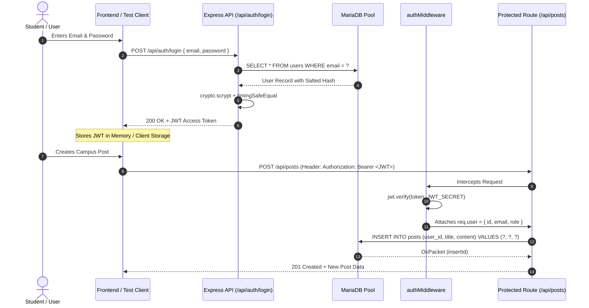
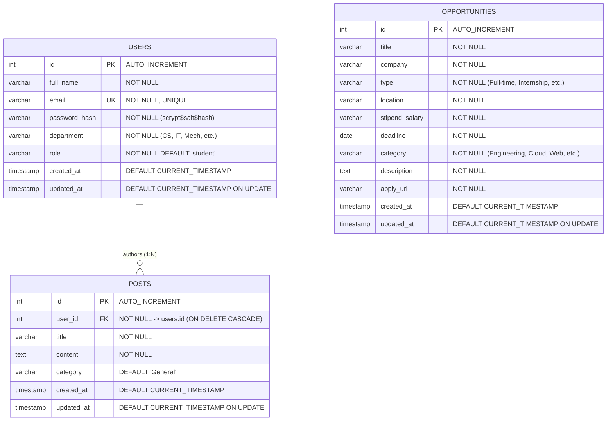

# Practical 15 — REST API & Database: Persistent KBTCOE Connect Backend

**Department of Computer Engineering**  
**MVP's KBT College of Engineering, Nashik (SPPU — Savitribai Phule Pune University)**  
**Course:** Web Development Laboratory (TE/BE Computer Engineering)  
**System:** KBTCOE Connect — The Professional Network for KBTCOE Students  
**Module:** Assignment 15 — RESTful Web Services & Relational Database Integration  

---

## 1. Title and Objective

### Title
**Design and Implementation of a Persistent RESTful API Backend Using Node.js, Express.js, and MySQL/MariaDB with Connection Pooling, Cryptographic Authentication, and Relational Data Modeling.**

### Laboratory Objectives
1. **RESTful Architecture:** Implement standard HTTP methods (`GET`, `POST`, `PUT`, `DELETE`) with appropriate status codes (`200 OK`, `201 Created`, `400 Bad Request`, `401 Unauthorized`, `403 Forbidden`, `404 Not Found`, `409 Conflict`, `500 Internal Server Error`).
2. **Relational Database Integration:** Connect an Express backend to a live MariaDB/MySQL database server using `mysql2/promise` with an enterprise connection pool.
3. **Database Security:** Eliminate SQL injection vulnerabilities by enforcing parameterized queries across all database operations.
4. **Cryptographic Authentication:** Implement password hashing using Node.js native `crypto.scrypt` with random 16-byte cryptographic salts and constant-time comparison (`crypto.timingSafeEqual`).
5. **Stateless Authorization:** Issue signed JSON Web Tokens (JWT) containing cryptographically signed payloads, and enforce authorization using Bearer token verification middleware.
6. **Relational Data Integrity:** Construct relational tables (`users`, `opportunities`, `posts`) with foreign key constraints (`ON DELETE CASCADE`) and verify data consistency.
7. **Resource Ownership Verification:** Restrict post modification (`PUT`) and deletion (`DELETE`) strictly to authenticated post authors, returning HTTP `403 Forbidden` for unauthorized actors.
8. **Centralized Error Handling:** Capture and normalize all runtime, syntax, validation, and database errors through a 4-parameter Express error-handling middleware without exposing database internals or stack traces.

---

## 2. SPPU Syllabus Mapping & Laboratory Context

In the SPPU Computer Engineering curriculum, Practical 15 demonstrates full-stack backend development by transitioning from the in-memory Express server constructed in **Assignment 14** and the PHP/MySQL CRUD in **Assignment 13** to an enterprise-grade, asynchronous, persistent Node.js/Express REST API service.

| Practical Component | Curriculum Topic | Real-World Application in KBTCOE Connect |
|:---|:---|:---|
| **API Endpoints** | RESTful Web Services & HTTP Verbs | Client-independent data exchange for web and mobile clients |
| **Database Driver** | Relational Database Connectivity | Persistent MariaDB/MySQL storage with async/await pool management |
| **Authentication** | Information Security & Cryptography | Salted scrypt hashing and stateless JSON Web Tokens |
| **Relational Schema**| Database Management Systems (DBMS) | Foreign keys, constraints, indexes, and cascading referential integrity |
| **Error Handling** | Robust Software Engineering | Safe client error responses, sanitized server-side diagnostics |

---

## 3. Theoretical Foundations

### 3.1 REST Architecture & Principles
Representational State Transfer (REST) is an architectural style defined by Roy Fielding:
- **Statelessness:** Each request from client to server must contain all of the information necessary to understand and complete the request. The server does not store client session state between requests.
- **Client-Server Separation:** The user interface concern (frontend React SPA or dashboard) is decoupled from data storage concerns (Express and MariaDB).
- **Uniform Interface:** Resources are identified in requests by URIs (`/api/opportunities`, `/api/posts`), representations are returned (JSON), and standard HTTP verbs express semantic actions.
- **Layered System:** A client cannot tell whether it is connected directly to the end server or to an intermediary (reverse proxy, load balancer, API gateway).

### 3.2 Parameterized SQL vs. SQL Injection
SQL injection occurs when untrusted user input is directly concatenated into a raw SQL query string:
```sql
-- VULNERABLE: Direct concatenation
SELECT * FROM users WHERE email = '` + req.body.email + `' AND password = '` + password + `'`;
```
If `req.body.email` contains `' OR '1'='1`, the authentication logic is bypassed.

In **Assignment 15**, all queries use **parameterized prepared statements**:
```javascript
// SECURE: MariaDB treats '?' strictly as literal data, never executable syntax
const [rows] = await db.execute(
  'SELECT * FROM users WHERE email = ?',
  [email.trim().toLowerCase()]
);
```
The database engine compiles the SQL query structure first, and then binds user values directly to parameter positions, rendering SQL injection syntactically impossible.

### 3.3 Connection Pooling vs. Single Connections
Creating a new TCP socket connection and executing the MySQL handshake for every incoming HTTP request introduces severe latency (~15–50ms per request) and exhaust database connection limits under concurrency.

`mysql2/promise` connection pooling maintains a reusable cache of active connections:
- Idle connections are kept alive.
- Incoming requests borrow an available connection, execute parameterized queries, and immediately return it to the pool.
- Connection limits prevent database server exhaustion during traffic spikes.

### 3.4 Cryptographic Password Hashing (`crypto.scrypt`)
MD5 and SHA-256 are cryptographic digests designed for rapid hashing, making them vulnerable to brute-force and GPU rainbow table attacks. KBTCOE Connect employs **scrypt**:
- **Memory-Hard Algorithm:** Requires substantial RAM to compute, mitigating custom ASIC and GPU cracking clusters.
- **Per-User Salt:** A cryptographically secure random 16-byte salt (`crypto.randomBytes(16)`) ensures identical passwords yield entirely distinct hashes, defeating precomputed rainbow tables.
- **Constant-Time Verification:** Using `crypto.timingSafeEqual` eliminates timing side-channel attacks by ensuring verification time is independent of the number of matching bytes.

### 3.5 JSON Web Tokens (JWT)
JWT represents claims securely between parties as a compact, URL-safe JSON object:
$$\text{JWT} = \text{base64Url}(\text{Header}) \,.\, \text{base64Url}(\text{Payload}) \,.\, \text{base64Url}(\text{Signature})$$
- **Header:** Specifies algorithm (`HS256`) and token type (`JWT`).
- **Payload:** Contains user ID, email, role, and expiration timestamp (`exp`).
- **Signature:** Generated by HMAC-SHA256 over header and payload with a secret server key. If an attacker modifies the payload (e.g. elevating role to admin), the signature check fails.

---

## 4. Architecture & Workflow

### 4.1 System Request-Response Pipeline
```mermaid
flowchart TD
    Client["Client / Frontend Dashboard"] -->|HTTP Request| Server["server.js (Express Application)"]
    
    subgraph Middleware Pipeline
        Server --> CORS["CORS & JSON Body Parser"]
        CORS --> Logger["Sanitized Request Logger"]
        Logger --> Static["Static Assets (public/)"]
        Static --> Router["Express Routers (/api/...)"]
    end

    subgraph Route Handlers & Controllers
        Router --> AuthRoute["/api/auth (authController.js)"]
        Router --> OppRoute["/api/opportunities (opportunityController.js)"]
        Router --> PostRoute["/api/posts (postController.js)"]
        
        AuthMiddleware["authMiddleware.js (Bearer JWT Check)"] -.->|Protects| PostWrite["POST / PUT / DELETE Posts & GET /auth/me"]
    end

    subgraph Persistence Layer
        AuthRoute --> DB["Database Pool (mysql2/promise)"]
        OppRoute --> DB
        PostRoute --> DB
        DB --> MariaDB[("MariaDB Database: kbtcoe_connect_api")]
    end

    subgraph Error Handling
        Router -->|Unmatched Route| NotFound["notFound.js (404)"]
        AuthRoute -->|Exception| CentralError["errorHandler.js (Central 4-Param Middleware)"]
        OppRoute -->|Exception| CentralError
        PostRoute -->|Exception| CentralError
    end

    CentralError -->|JSON Response (No Stack Trace)| Client
    NotFound -->|JSON Response| Client
```

### 4.2 JWT Authentication & Authorization Flow


---

## 5. Directory & File Structure

```
assignments/15-REST_API_Database/
├── .env                          # Local environment variables (PORT, DB credentials, JWT secret)
├── .env.example                  # Template configuration for deployment/grading
├── .gitignore                    # Prevents node_modules/ and sensitive .env leaks
├── package.json                  # Project manifest, scripts, and dependencies
├── package-lock.json             # Deterministic dependency lockfile
├── server.js                     # Main Express server entry point and lifecycle manager
├── config/
│   └── database.js               # mysql2/promise connection pool & health checker
├── controllers/
│   ├── authController.js         # Register, Login, and Profile (/auth/me) logic
│   ├── opportunityController.js  # CRUD controller for campus opportunities
│   └── postController.js         # CRUD controller for posts with ownership verification
├── database/
│   ├── schema.sql                # DDL script creating users, opportunities, and posts tables
│   └── seed.sql                  # Initial seed records for testing and demonstration
├── middleware/
│   ├── authMiddleware.js         # JWT Bearer token authentication guard
│   ├── errorHandler.js           # Central 4-parameter error handler (scrubs internal errors)
│   └── notFound.js               # 404 handler listing all available API endpoints
├── public/
│   ├── index.html                # Interactive API test dashboard (HTML5, Accessible)
│   ├── style.css                 # KBTCOE-themed CSS styling (Navy #1E3A8A, Blue #2563EB)
│   ├── app.js                    # Vanilla JS client exercising all REST endpoints live
│   └── kbtcoe-logo.svg           # Scalable KBTCOE institutional emblem
├── test.js                       # Comprehensive automated verification test suite
└── utils/
    └── validators.js             # Crypto scrypt helpers, JWT utilities, and validation functions
```

---

## 6. Database Schema & Relational Design

The database `kbtcoe_connect_api` contains three relational entities enforcing referential integrity:



### Relational Features:
- **Primary Keys (`id`):** Standard `INT AUTO_INCREMENT` providing surrogate integer keys.
- **Unique Constraints:** `users.email` is declared `UNIQUE` to prevent account duplication.
- **Foreign Key (`posts.user_id`):** References `users.id` with `ON DELETE CASCADE`. Deleting a user automatically purges associated posts, preventing orphaned records.
- **Timestamps:** Automatic `created_at` and `updated_at` tracking with database-native triggers.
- **Indexes:** Explicit indexes on `opportunities(category)` and `posts(user_id)` accelerate join and filter queries.

---

## 7. Environment Configuration

All environment-specific parameters are externalized into `.env` (configured via `dotenv`):

```ini
# Server Configuration
PORT=5000
NODE_ENV=development

# Database Configuration (MariaDB / MySQL)
DB_HOST=localhost
DB_PORT=3306
DB_USER=root
DB_PASSWORD=
DB_NAME=kbtcoe_connect_api
DB_CONNECTION_LIMIT=10

# Security Configuration
JWT_SECRET=kbtcoe_connect_te_be_web_dev_jwt_secret_key_2026_secure
JWT_EXPIRES_IN=24h
```

> [!IMPORTANT]
> The `.env` file contains sensitive local credentials and is excluded from git tracking via `.gitignore`. Always distribute `.env.example` as a template for other laboratory machines.

---

## 8. Prerequisites & Installation Instructions

### 8.1 System Requirements
1. **Node.js:** v18.0.0 or higher (Verified on Node v24.20.0).
2. **npm:** v9.0.0 or higher (Verified on npm 11.19.0).
3. **Database Server:** MariaDB 10.4+ or MySQL 8.0+ running on port 3306.

### 8.2 Installation Steps
Open PowerShell or a terminal inside the project root:
```powershell
cd c:\Users\administrator.FABEXENG\Desktop\Projecy\assignments\15-REST_API_Database
npm install
```

Installed production dependencies:
- `express`: Fast, unopinionated minimalist web framework.
- `mysql2`: High-performance MySQL/MariaDB client supporting promises and connection pooling.
- `dotenv`: Loads environment variables from `.env`.
- `jsonwebtoken`: Implementation of JSON Web Tokens (RFC 7519).

---

## 9. Database Initialization & Seeding Steps

Execute the SQL scripts against your local MariaDB/MySQL instance.

### Using MariaDB/MySQL Command Line:
```powershell
# Create database and tables
mysql -u root -e "source c:/Users/administrator.FABEXENG/Desktop/Projecy/assignments/15-REST_API_Database/database/schema.sql"

# Populate initial seed data
mysql -u root -e "source c:/Users/administrator.FABEXENG/Desktop/Projecy/assignments/15-REST_API_Database/database/seed.sql"
```

### Pre-Seeded Demonstration Accounts:
| Name | Email | Password | Department | Role |
|:---|:---|:---|:---|:---|
| Aarav Sharma | `aarav.sharma@kbtcoe.org` | `Student@123` | Computer Engineering | student |
| Priya Patil | `priya.patil@kbtcoe.org` | `Student@123` | Information Technology | student |

---

## 10. Server Startup Instructions

### Running the Server:
```powershell
# From assignments/15-REST_API_Database:
npm start
```

Or run via Node directly:
```powershell
node server.js
```

### Terminal Output:
```
============================================================
  KBTCOE Connect - Persistent REST API Server
  Department of Computer Engineering, MVP's KBTCOE Nashik
============================================================
[2026-10-15 22:25:00] Initializing database connection pool...
[2026-10-15 22:25:00] Database connected successfully to 'kbtcoe_connect_api' at localhost:3306
[2026-10-15 22:25:00] Server running at http://localhost:5000
[2026-10-15 22:25:00] Health check available at: http://localhost:5000/api/health
[2026-10-15 22:25:00] Interactive Dashboard at: http://localhost:5000/
============================================================
```

---

## 11. REST API Endpoint Specification

### 11.1 System Health
| Method | Endpoint | Auth | Description | Status Codes |
|:---|:---|:---|:---|:---|
| `GET` | `/api/health` | None | Server and MariaDB connectivity status | `200`, `503` |

### 11.2 Authentication Endpoints
| Method | Endpoint | Auth | Request Body | Status Codes | Description |
|:---|:---|:---|:---|:---|:---|
| `POST` | `/api/auth/register` | None | `{ full_name, email, password, department, role? }` | `201`, `400`, `409` | Registers a new student, returns JWT |
| `POST` | `/api/auth/login` | None | `{ email, password }` | `200`, `400`, `401` | Validates credentials, returns JWT |
| `GET` | `/api/auth/me` | Bearer JWT | None | `200`, `401`, `404` | Returns profile of authenticated user |

### 11.3 Campus Opportunities Endpoints
| Method | Endpoint | Auth | Query / Body Params | Status Codes | Description |
|:---|:---|:---|:---|:---|:---|
| `GET` | `/api/opportunities` | None | Query: `?category=...&search=...` | `200`, `500` | List opportunities with filtering |
| `GET` | `/api/opportunities/:id` | None | Param: `id` | `200`, `400`, `404` | Get opportunity details by ID |
| `POST` | `/api/opportunities` | None | Body: Opportunity fields | `201`, `400` | Create a new campus opportunity |
| `PUT` | `/api/opportunities/:id` | None | Param: `id`, Body: updated fields | `200`, `400`, `404` | Update existing opportunity |
| `DELETE`| `/api/opportunities/:id` | None | Param: `id` | `200`, `400`, `404` | Delete opportunity by ID |

### 11.4 Community Posts Endpoints
| Method | Endpoint | Auth | Query / Body Params | Status Codes | Description |
|:---|:---|:---|:---|:---|:---|
| `GET` | `/api/posts` | None | None | `200`, `500` | List posts with author details joined |
| `GET` | `/api/posts/:id` | None | Param: `id` | `200`, `400`, `404` | Get single post by ID |
| `POST` | `/api/posts` | Bearer JWT | Body: `{ title, content, category? }` | `201`, `400`, `401` | Create post (author = `req.user.id`) |
| `PUT` | `/api/posts/:id` | Bearer JWT | Body: `{ title, content, category? }` | `200`, `400`, `401`, `403`, `404` | Update post (Author ownership enforced) |
| `DELETE`| `/api/posts/:id` | Bearer JWT | None | `200`, `400`, `401`, `403`, `404` | Delete post (Author ownership enforced) |

---

## 12. Complete Request & Response Examples

### 12.1 Health Check (`GET /api/health`)
**cURL:**
```bash
curl -i -X GET http://localhost:5000/api/health
```
**Response (200 OK):**
```json
{
  "success": true,
  "service": "KBTCOE Connect REST API",
  "version": "1.0.0",
  "status": "healthy",
  "timestamp": "2026-10-15T16:55:00.000Z",
  "database": {
    "status": "connected",
    "name": "kbtcoe_connect_api"
  }
}
```

### 12.2 User Login (`POST /api/auth/login`)
**PowerShell:**
```powershell
$body = @{
    email = "aarav.sharma@kbtcoe.org"
    password = "Student@123"
} | ConvertTo-Json

Invoke-RestMethod -Uri "http://localhost:5000/api/auth/login" -Method Post -ContentType "application/json" -Body $body
```
**Response (200 OK):**
```json
{
  "success": true,
  "message": "Login successful. Welcome back!",
  "data": {
    "token": "eyJhbGciOiJIUzI1NiIsInR5cCI6IkpXVCJ9.eyJpZCI6MSwiZW1haWwiOiJhYXJ2LnNoYXJtYUBrYnRjb2Uub3JnIiwicm9sZSI6InN0dWRlbnQiLCJpYXQiOjE3OTIxNDAwMDAsImV4cCI6MTc5MjIyNjQwMH0...",
    "user": {
      "id": 1,
      "full_name": "Aarav Sharma",
      "email": "aarav.sharma@kbtcoe.org",
      "department": "Computer Engineering",
      "role": "student"
    }
  }
}
```

### 12.3 Create Protected Post (`POST /api/posts`)
**cURL:**
```bash
curl -i -X POST http://localhost:5000/api/posts \
  -H "Content-Type: application/json" \
  -H "Authorization: Bearer <TOKEN>" \
  -d '{"title":"Smart India Hackathon 2026 - KBTCOE Team Formed","content":"Our computer engineering team has registered for SIH 2026 under the Smart Automation theme. Reach out for collaboration!","category":"Hackathons"}'
```
**Response (201 Created):**
```json
{
  "success": true,
  "message": "Community post published successfully.",
  "data": {
    "id": 5,
    "user_id": 1,
    "title": "Smart India Hackathon 2026 - KBTCOE Team Formed",
    "content": "Our computer engineering team has registered for SIH 2026 under the Smart Automation theme. Reach out for collaboration!",
    "category": "Hackathons",
    "author_name": "Aarav Sharma",
    "author_email": "aarav.sharma@kbtcoe.org",
    "author_department": "Computer Engineering",
    "created_at": "2026-10-15T16:56:00.000Z"
  }
}
```

### 12.4 Forbidden Operation Test (`DELETE /api/posts/:id` by Non-Owner)
If Priya attempts to delete Aarav's post (ID: 1):
**Response (403 Forbidden):**
```json
{
  "success": false,
  "error": "Forbidden",
  "message": "Access forbidden. You do not have permission to delete posts authored by other users."
}
```

---

## 13. Security Architecture

1. **SQL Injection Prevention:**
   All queries utilize parameterized inputs via `db.execute(sql, [params])`. Input parameters are sent out-of-band from query syntax.
2. **Cryptographic Password Storage:**
   Passwords are never stored in plaintext. Passwords are processed with Node's native `crypto.scryptSync(password, salt, 64)` using unique 16-byte cryptographically random salts (`crypto.randomBytes(16)`).
3. **Timing Attack Protection:**
   Password validation utilizes `crypto.timingSafeEqual()` to ensure verification execution time is constant regardless of where mismatches occur.
4. **JWT Verification & Role Preservation:**
   Signed tokens enforce an immutable user identity (`req.user.id`). Post author identity cannot be spoofed by modifying request payloads because the controller strictly sets `user_id = req.user.id`.
5. **Resource Ownership Authorization:**
   Before updating or deleting posts, the controller performs a pre-query to ascertain record ownership. If `record.user_id !== req.user.id`, execution terminates with HTTP `403 Forbidden`.
6. **Sanitized Diagnostics:**
   Stack traces and raw database errors are strictly isolated from client responses to prevent internal information leakage. Sensitive request headers (Authorization) and passwords are scrubbed before logging.

---

## 14. Error Handling Strategy

A centralized 4-parameter error-handling middleware (`(err, req, res, next)`) catches and normalizes all server-side issues:

| Scenario | HTTP Status | Response Format |
|:---|:---|:---|
| Malformed JSON Body | `400 Bad Request` | `{"success": false, "error": "Bad Request", "message": "Malformed JSON payload in request body."}` |
| Validation Failure | `400 Bad Request` | `{"success": false, "error": "Validation Error", "details": [...]}` |
| Missing / Invalid JWT | `401 Unauthorized` | `{"success": false, "error": "Unauthorized", "message": "Access token is missing or malformed."}` |
| Ownership Violation | `403 Forbidden` | `{"success": false, "error": "Forbidden", "message": "Access forbidden. You do not have permission..."}` |
| Resource Not Found | `404 Not Found` | `{"success": false, "error": "Not Found", "message": "Requested resource was not found."}` |
| Duplicate Email | `409 Conflict` | `{"success": false, "error": "Conflict", "message": "An account with this email address already exists."}` |
| Database Exception | `500 Internal Error`| `{"success": false, "error": "Database Error", "message": "A database error occurred..."}` |

---

## 15. Frontend Dashboard Integration

An interactive HTML5/CSS/JavaScript console is served directly at the server root (`http://localhost:5000/`):
- **Live Health Status:** Queries `/api/health` every 10 seconds and visually displays MariaDB connection state with an active pulse indicator.
- **Authentication Panel:** Allows logging in as pre-seeded student accounts (Aarav or Priya) with one-click credential prefill.
- **Token Management:** Displays current active JWT and active user session metadata.
- **Opportunities Explorer & Creator:** Search, filter by category, view cards, and create new opportunities via REST.
- **Community Post Feed & CRUD:** Displays posts with author tags; dynamically renders Edit/Delete buttons exclusively for posts authored by the active logged-in user.
- **Raw API Console:** Real-time request/response viewer displaying HTTP method, endpoint, status code, latency, and formatted JSON output.

---

## 16. Automated Testing & Verification Guide (`test.js`)

The project contains a standalone test script `test.js` that spins up an Express instance on an ephemeral port (`5001`), executes 21 automated integration tests against live MariaDB, and shuts down cleanly.

### Running the Test Suite:
```powershell
cd c:\Users\administrator.FABEXENG\Desktop\Projecy\assignments\15-REST_API_Database
npm test
```

### Test Coverage Checklist:
1. `GET /api/health` — Confirms database connectivity status (`200 OK`).
2. `GET /api/opportunities` — Validates JSON array return.
3. `GET /api/opportunities?category=Web` — Validates filtered query matching.
4. `GET /api/opportunities/:id` — Fetches individual record.
5. `GET /api/opportunities/99999` — Verifies `404 Not Found`.
6. `GET /api/opportunities/invalid` — Verifies `400 Bad Request`.
7. `POST /api/opportunities` — Creates opportunity (`201 Created`).
8. `PUT /api/opportunities/:id` — Updates opportunity record (`200 OK`).
9. `DELETE /api/opportunities/:id` — Deletes opportunity record (`200 OK`).
10. `POST /api/auth/register` — Registers new student and returns signed JWT (`201 Created`).
11. `POST /api/auth/register` (Duplicate) — Checks email collision rejection (`409 Conflict`).
12. `POST /api/auth/login` (Valid) — Validates credential verification and token issue (`200 OK`).
13. `POST /api/auth/login` (Invalid) — Validates bad credentials response (`401 Unauthorized`).
14. `GET /api/auth/me` (With Bearer Token) — Validates protected user profile (`200 OK`).
15. `GET /api/auth/me` (Without Token) — Validates protection guard (`401 Unauthorized`).
16. `GET /api/posts` — Validates multi-table SQL join (post + author name/department).
17. `POST /api/posts` (With Bearer Token) — Creates post bound to user ID (`201 Created`).
18. `PUT /api/posts/:id` (By Owner) — Permits update by post author (`200 OK`).
19. `PUT /api/posts/:id` (By Non-Owner) — Enforces ownership check (`403 Forbidden`).
20. `DELETE /api/posts/:id` (By Non-Owner) — Enforces deletion guard (`403 Forbidden`).
21. Centralized Error Handling — Confirms malformed JSON returns clean `400` without stack traces.

---

## 17. Troubleshooting & Common Pitfalls

| Symptom / Error | Root Cause | Solution |
|:---|:---|:---|
| `ECONNREFUSED 127.0.0.1:3306` | MariaDB / MySQL server is not running | Start the MariaDB/MySQL service in XAMPP or Windows Services. |
| `ER_ACCESS_DENIED_ERROR` | Incorrect DB credentials in `.env` | Ensure `DB_USER` and `DB_PASSWORD` in `.env` match local MySQL configuration. |
| `ER_NO_SUCH_TABLE` | Schema not imported into MariaDB | Run `mysql -u root < database/schema.sql`. |
| `TokenExpiredError` | JWT lifespan (`24h`) elapsed | Re-authenticate via `/api/auth/login` to obtain a fresh token. |
| `403 Forbidden on Post Edit` | Current user ID does not match `post.user_id` | Log in as the author who created the post, or create a new post with current token. |

---

## 18. Evolution & Progressive Contribution to Final Project

Practical 15 represents the persistent architectural foundation of the full KBTCOE Connect portal:
- **From Assignment 10 (Fetch API & JSON):** Replaced static mock JSON files with live REST endpoints backed by MariaDB.
- **From Assignment 13 (PHP & MySQL):** Migrated relational SQL patterns into an asynchronous JavaScript runtime using connection pooling.
- **From Assignment 14 (In-Memory Express):** Upgraded volatile in-memory repositories into persistent MariaDB relational models.
- **Transitioning to Assignment 16 (Full-Stack Production Capstone):** The RESTful endpoints developed here (`/api/auth`, `/api/opportunities`, `/api/posts`) will be integrated with the Assignment 08/09 React Single-Page Application to deliver the unified final KBTCOE Connect portal.

---

## 19. Practical Outcomes & Pedagogical Takeaways

Upon completion of this practical, students have demonstrated:
1. Architectural understanding of the client-server separation in modern decoupled web systems.
2. The ability to configure, query, and manage a MariaDB connection pool in Node.js.
3. Industry-standard defense against SQL injection via parameterized prepared statements.
4. Cryptographic hygiene using memory-hard hashing (`scrypt`) and constant-time comparison.
5. Stateless session management using signed JSON Web Tokens (JWT) and bearer middleware guards.
6. Ownership-based authorization control protecting database records from unauthorized mutation.

---

## 20. Viva Voce Examination Questions & Detailed Answers

### Q1: What makes an API "RESTful", and what are its core architectural constraints?
**Answer:** An API is RESTful when it conforms to the Representational State Transfer constraints formulated by Roy Fielding:
1. **Statelessness:** The server preserves no client session state between requests; every request carries complete credentials and context.
2. **Client-Server Separation:** User interface concerns are decoupled from data storage concerns.
3. **Uniform Interface:** Resources are identified via standard URIs, manipulated through standard representations (JSON), using standard HTTP methods (`GET`, `POST`, `PUT`, `DELETE`).
4. **Cacheability:** Responses must define themselves as cacheable or non-cacheable to optimize network efficiency.
5. **Layered System:** Architectural layers (proxies, gateways) can exist transparently between client and server.

### Q2: Why is raw string concatenation in SQL queries dangerous, and how do parameterized queries mitigate SQL injection?
**Answer:** Raw concatenation treats user input as executable SQL syntax. An attacker submitting `' OR '1'='1` can alter query logic, dump unauthorized tables, or delete data. Parameterized queries mitigate this by utilizing two-phase execution: first, the SQL statement template is compiled and parsed by the database engine with placeholder symbols (`?`); second, the parameters are transmitted separately and bound strictly as literal values. Even if a parameter contains SQL syntax, it is treated purely as data, rendering SQL injection impossible.

### Q3: What is the purpose of a database connection pool, and why is it preferred over opening individual connections?
**Answer:** Opening a TCP connection and performing the database handshake takes significant overhead (~15–50 ms). In high-concurrency environments, creating a connection per request would quickly exhaust operating system sockets and database connection limits (`max_connections`). A connection pool pre-allocates and maintains a set of reusable connections. Worker requests borrow an idle connection, execute their query, and return it immediately to the pool.

### Q4: Why is `crypto.scrypt` preferred over standard SHA-256 or MD5 for password storage?
**Answer:** SHA-256 and MD5 are cryptographic digest algorithms optimized for fast hardware computation, making them vulnerable to brute-force cracking at billions of hashes per second using GPUs and ASICs. In contrast, `scrypt` is a password-based key derivation function that is intentionally **memory-hard** and **CPU-intensive**. It requires large amounts of RAM to calculate, rendering parallel GPU and ASIC attacks economically infeasible.

### Q5: What is the role of a cryptographic salt in password hashing?
**Answer:** A salt is a cryptographically random byte sequence (e.g., 16 bytes generated by `crypto.randomBytes`) combined with the password before hashing. The salt ensures that two users with identical passwords will produce completely different hash values. This prevents attackers from using precomputed rainbow tables to reverse passwords and defeats batch attacks against multiple users.

### Q6: What is a timing attack, and how does `crypto.timingSafeEqual` prevent it?
**Answer:** In standard string comparison (`===`), execution terminates at the first non-matching byte. An attacker measuring request response latency with nanosecond precision could deduce character by character whether early bytes match. `crypto.timingSafeEqual` compares two memory buffers in constant time, meaning the elapsed duration is identical whether all bytes match or the first byte mismatches, completely eliminating timing side-channel leakage.

### Q7: Explain the structure of a JSON Web Token (JWT) and how its signature is validated.
**Answer:** A JWT consists of three Base64URL-encoded parts separated by dots:
1. **Header:** Contains the algorithm (`HS256`) and token type (`JWT`).
2. **Payload:** Contains claims (e.g. `userId`, `email`, `role`, and expiration timestamp `exp`).
3. **Signature:** Calculated as `HMACSHA256(base64Url(Header) + "." + base64Url(Payload), secret)`.
When the server receives a token in the `Authorization: Bearer <token>` header, it recomputes the signature using its private secret and compares it against the token's signature. If any payload data has been tampered with, the signatures will not match.

### Q8: What is the semantic difference between HTTP 401 Unauthorized and HTTP 403 Forbidden?
**Answer:** 
- **HTTP 401 Unauthorized:** Indicates missing or invalid authentication credentials. The client has not identified itself (e.g. missing, expired, or malformed JWT). Re-authenticating with valid credentials may grant access.
- **HTTP 403 Forbidden:** Indicates that the client's identity is authenticated and known, but the client does not possess the required permissions or rights to access or manipulate the target resource (e.g., Student A trying to delete a community post authored by Student B).

### Q9: What is the purpose of the 4th parameter in Express middleware, and how does Express differentiate error handlers from normal middleware?
**Answer:** Express identifies middleware by its function arity (`Function.length`). Standard middleware functions declare three parameters: `(req, res, next)`. An error-handling middleware declares exactly four parameters: `(err, req, res, next)`. When an error occurs in any route or previous middleware (either thrown or passed to `next(err)`), Express skips all remaining standard middleware in the pipeline and routes directly to the next four-parameter error-handling middleware.

### Q10: How does referential integrity work with `ON DELETE CASCADE` in MySQL/MariaDB?
**Answer:** Referential integrity ensures that relationships between tables remain consistent. In `kbtcoe_connect_api`, the `posts` table defines a foreign key `user_id` pointing to `users(id)`. With `ON DELETE CASCADE`, if a row in the `users` table is deleted, MariaDB automatically deletes all child rows in the `posts` table that reference that `user_id`. This eliminates dangling references and prevents orphaned records without requiring manual multi-table deletion queries.

### Q11: Why is it important to prevent stack traces from reaching production API clients?
**Answer:** Stack traces expose internal implementation details, including database engine types, table and column names, internal server file paths, dependency versions, and operating system details. Attackers use this reconnaissance information to identify known Common Vulnerabilities and Exposures (CVEs) or formulate targeted exploits. Production APIs should return clean, generic error codes and user-friendly messages while logging detailed diagnostics only to secure server-side monitoring logs.

### Q12: How does the resource ownership check work in `postController.js`?
**Answer:** When an update (`PUT /api/posts/:id`) or delete (`DELETE /api/posts/:id`) request arrives:
1. `authMiddleware` verifies the Bearer JWT and sets `req.user.id`.
2. The controller executes a parameterized query to find the post by ID: `SELECT * FROM posts WHERE id = ?`.
3. If no record is found, it returns `404 Not Found`.
4. If the record exists, it checks `if (post.user_id !== req.user.id)`.
5. If they do not match, the controller halts immediately and responds with `403 Forbidden` (`"Access forbidden. You do not have permission to modify/delete posts authored by other users."`).
6. If they match, the update or delete query is executed and responds with `200 OK`.

---

**MVP's KBT College of Engineering, Nashik — Department of Computer Engineering**  
*Academic Year 2025–2026 | Web Development Laboratory*
