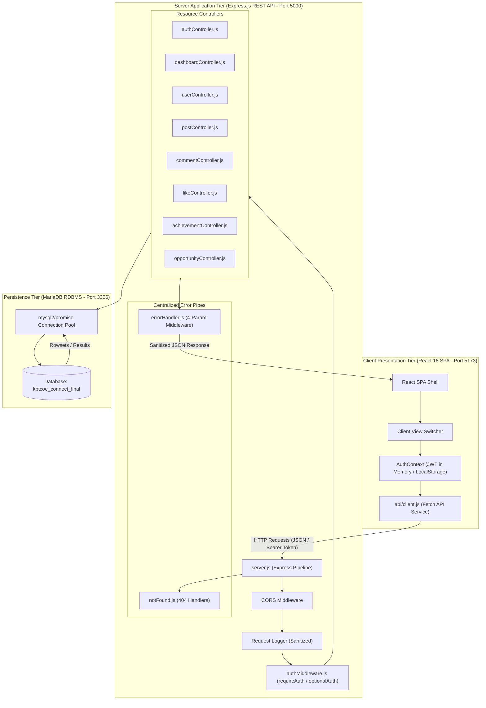
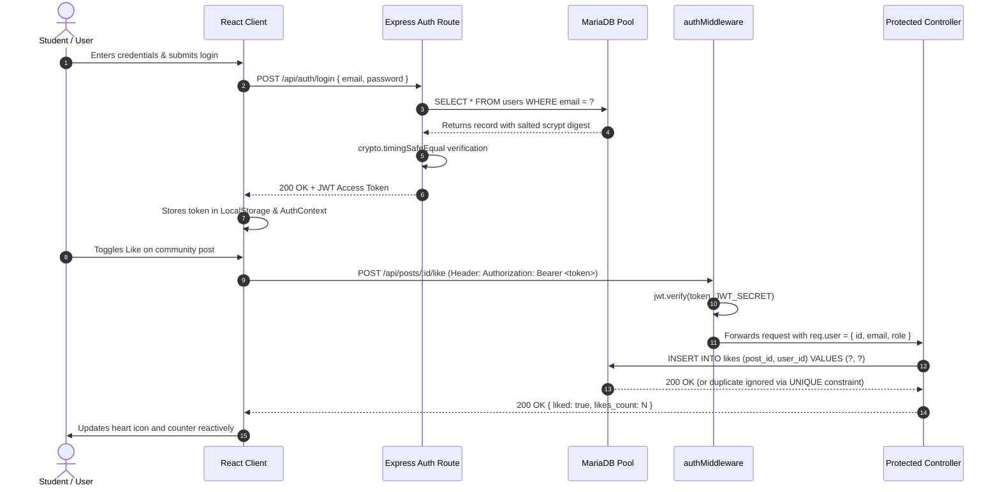
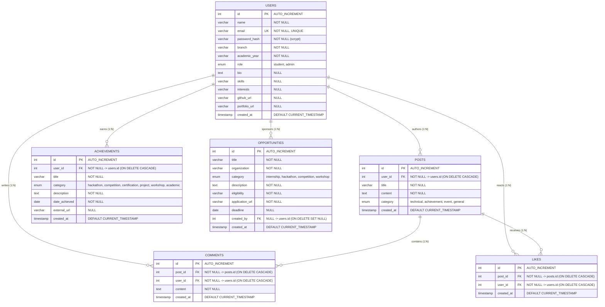

# Practical 16: KBTCOE Connect — Final Full-Stack Web Development Project

**Department of Computer Engineering**  
**MVP's K.B.T. College of Engineering, Nashik (SPPU — Savitribai Phule Pune University)**  
**Course:** Web Development Laboratory (TE/BE Computer Engineering)  
**System:** KBTCOE Connect — The Professional Network for KBTCOE Students  
**Capstone Deliverable:** Integrated React 18 SPA + Node.js/Express REST API + MariaDB Relational Database  

---

## 1. Title and Abstract

### Title
**Design and Implementation of an Integrated Full-Stack Collegiate Networking & Professional Development Platform (KBTCOE Connect) Using React 18, Node.js, Express.js, and MariaDB.**

### Abstract
Modern collegiate engineering education necessitates platforms that bridge academic coursework, peer technical collaboration, and industry opportunities. **KBTCOE Connect** is a full-stack, decoupled single-page web application engineered as the capstone submission for the SPPU Web Development Laboratory. The system integrates an interactive, component-driven client frontend built with **React 18** and **Vite**, an enterprise RESTful application layer built on **Node.js** and **Express.js**, and an ACID-compliant relational persistence layer utilizing **MariaDB/MySQL**. 

The platform delivers a complete suite of collegiate networking features: real-time dashboard analytics, salted cryptographic authentication (`crypto.scrypt`), stateless JSON Web Token (JWT) session guards, student directory search with multi-criteria filtering, user portfolio management, an interactive community discussion feed with live like counters and comment threads, verified student achievement tracking, and a campus opportunity board with deadline status tracking. Strict resource ownership validation enforces authorization boundaries across all mutative operations, preventing privilege escalation.

---

## 2. SPPU Syllabus Context & Course Outcome Mapping

Assignment 16 synthesizes all 15 preceding university laboratory practicals into a unified production architecture:

| SPPU Course Outcome (CO) | Syllabus Focus | KBTCOE Connect Practical Implementation |
|:---|:---|:---|
| **CO1: Client Markup & Semantics** | HTML5, Semantic Elements | Semantic landmarks (`<header>`, `<nav>`, `<main>`, `<article>`, `<section>`, `<footer>`) derived from Assignments 01 & 02. |
| **CO2: Responsive Design & Layouts**| CSS3, Flexbox, CSS Grid, Media Queries | Standardized institutional design system (`#1E3A8A`, `#2563EB`, `#F8FAFC`, `#E2E8F0`), Flexbox layouts, and Grid reflow from Assignments 03, 04, and 05. |
| **CO3: Client Scripting & Validation** | JavaScript ES6+, DOM Manipulation | RegEx validation from Assignment 07, array filtering from Assignment 06, and live event handling from Assignment 11. |
| **CO4: Modern Frontend Frameworks** | React 18, JSX, Hooks, SPA State | Component hierarchy, `useState`, `useEffect`, and Context API (`AuthContext`) synthesizing Assignments 08 & 09. |
| **CO5: Asynchronous Communication** | Fetch API, Promises, REST Protocols | Centralized API client service with async/await, status code handling, and defensive JSON schema parsing from Assignment 10. |
| **CO6: Backend & Database Persistence**| Node/Express, MySQL, Security | Parameterized queries, connection pools, JWT auth, and ownership authorization synthesizing Assignments 13, 14, and 15. |

---

## 3. Problem Statement & Motivation

Collegiate engineering campuses typically suffer from fragmented communication channels:
1. Technical announcements and hackathon notices are dispersed across informal chat groups and unindexed email threads.
2. Students lack a centralized institutional space to display verified achievements, open-source repositories, and technical blogs.
3. Industry placement coordinators struggle to broadcast internships and workshops directly to relevant engineering branches.
4. Existing commercial networks lack institutional context (e.g. SPPU engineering departments, academic years, college technical clubs).

**Motivation:** KBTCOE Connect addresses these challenges by providing an institutional web portal where KBTCOE students discover opportunities, publish technical write-ups, showcase competitive achievements, and connect across engineering disciplines.

---

## 4. Aim and Objectives

### Aim
To architect, build, verify, and demonstrate an end-to-end full-stack web application implementing professional engineering standards, client-server decoupling, cryptographic hygiene, and database referential integrity.

### Primary Objectives
1. **Frontend Architecture:** Construct a responsive React 18 Single-Page Application using Vite, functional components, custom hooks, and centralized state.
2. **Backend Architecture:** Build a modular Express.js REST API with sanitized logging, centralized error handling, and parameter validation.
3. **Database Relational Design:** Formulate a normalized MariaDB relational schema (`kbtcoe_connect_final`) with primary keys, foreign keys (`ON DELETE CASCADE`), indexes, and unique constraints.
4. **Information Security:** Eliminate SQL injection through parameterized statements, secure passwords via `crypto.scrypt` with random 16-byte salts and `crypto.timingSafeEqual`, and enforce stateless JWT Bearer authorization.
5. **Ownership & Access Control:** Ensure students can only mutate their own content, returning HTTP `403 Forbidden` for unauthorized actors.
6. **Educational Integrity:** Preserve Assignments 01 through 15 completely untouched and independently runnable.

---

## 5. System Scope & Educational Intent

- **Target Audience:** Undergraduates, faculty, and placement coordinators at MVP's K.B.T. College of Engineering, Nashik.
- **Educational Scope:** Engineered for laboratory evaluation, code defense, and viva voce examination. It demonstrates software engineering principles rather than claiming unverified commercial production readiness.
- **Fictional Demonstration Data:** Seeded with realistic profiles, hackathon achievements, and campus notices.

---

## 6. Hardware and Software Environment Requirements

### Hardware Requirements
- **Processor:** Intel Core i3 / AMD Ryzen 3 or higher (Tested on 64-bit AMD64 architecture).
- **RAM:** Minimum 4 GB (8 GB recommended for concurrent Vite dev server and MariaDB service).
- **Storage:** 500 MB free disk space for Node modules and database tables.

### Software Requirements
- **Operating System:** Windows 10/11, Ubuntu 20.04+, or macOS (Verified on Windows 11).
- **Runtime Environment:** Node.js v18.0.0 or higher (Verified on **v24.20.0**).
- **Package Manager:** npm v9.0.0 or higher (Verified on **11.19.0**).
- **Database Server:** MariaDB 10.4+ or MySQL 8.0+ running on port 3306 (Verified on **MariaDB 13.0.2**).
- **Web Browser:** Google Chrome, Mozilla Firefox, or Microsoft Edge with ES6 and modern CSS support.

---

## 7. Full-Stack Technology Stack & Architecture

```
Client (React 18 SPA)          Application Layer (Express API)          Persistence Layer (MariaDB)
┌──────────────────────┐       ┌──────────────────────────────┐       ┌───────────────────────────┐
│ • React 18.3.1       │       │ • Node.js v24 + Express 4.21 │       │ • MariaDB 13.0 (Port 3306)│
│ • Vite 5.4.21 Build  │ HTTP  │ • JWT Bearer Auth Guard      │ SQL   │ • DB: kbtcoe_connect_final│
│ • Context API (Auth) │◄─────►│ • scrypt Password Hashing    │◄─────►│ • Foreign Keys + Cascades │
│ • Responsive CSS3    │ JSON  │ • Parameterized SQL Engine   │ Pool  │ • Unique Constraints      │
│ • Fetch API Client   │       │ • Central Error Middleware   │       │ • Performance Indexes     │
└──────────────────────┘       └──────────────────────────────┘       └───────────────────────────┘
```

---

## 8. System Architecture & Workflows

### 8.1 System Tiered Architecture Diagram


### 8.2 Authentication & Authorization Sequence


---

## 9. Database Relational Design

The database `kbtcoe_connect_final` contains six normalized entities:



### Key Relational Features
1. **Duplicate Like Prevention:** The table `likes` establishes a compound unique key: `UNIQUE KEY uk_post_user_like (post_id, user_id)`. MariaDB rejects duplicate like entries at the database engine level, preventing race condition inflation.
2. **Cascading Referential Integrity:** All user-generated content (`posts`, `comments`, `likes`, `achievements`) binds to `users.id` with `ON DELETE CASCADE`. Deleting a student account automatically cleans up child rows, eliminating orphaned references.
3. **Query Optimization:** Explicit B-tree indexes are declared on foreign keys and filter columns (`idx_posts_user_id`, `idx_posts_category`, `idx_comments_post_id`, `idx_opp_category`, `idx_achievements_user_id`).

---

## 10. Backend RESTful API Specification

| Method | Endpoint | Auth | Role / Guard | Description | Status Codes |
|:---|:---|:---|:---|:---|:---|
| `GET` | `/api/health` | Public | None | Service & MariaDB connection health | `200`, `503` |
| `GET` | `/api/dashboard/stats` | Public | None | Aggregated counts, recent posts & opportunities | `200`, `500` |
| `POST`| `/api/auth/register` | Public | None | Student account registration (default role: student) | `201`, `400`, `409` |
| `POST`| `/api/auth/login` | Public | None | Credential authentication, returns signed JWT | `200`, `400`, `401` |
| `GET` | `/api/auth/me` | Bearer | None | Returns profile of authenticated token bearer | `200`, `401`, `404` |
| `GET` | `/api/users` | Public | None | Search & filter students by department and year | `200`, `500` |
| `GET` | `/api/users/:id` | Public | None | Single student profile with achievements & posts | `200`, `400`, `404` |
| `PUT` | `/api/users/profile` | Bearer | `req.user.id` | Update authenticated user's own profile | `200`, `400`, `401` |
| `GET` | `/api/posts` | Optional| None | List posts with author details & like counts | `200`, `400`, `500` |
| `GET` | `/api/posts/:id` | Optional| None | Single post with discussion thread comments | `200`, `400`, `404` |
| `POST`| `/api/posts` | Bearer | `req.user.id` | Publish community post | `201`, `400`, `401` |
| `PUT` | `/api/posts/:id` | Bearer | Author / Admin | Update community post (Ownership checked) | `200`, `400`, `403`, `404` |
| `DELETE`| `/api/posts/:id`| Bearer | Author / Admin | Delete community post (Ownership checked) | `200`, `400`, `403`, `404` |
| `GET` | `/api/posts/:id/comments` | Public | None | Fetch comments for a post | `200`, `400`, `500` |
| `POST`| `/api/posts/:id/comments` | Bearer | `req.user.id` | Post a comment in discussion thread | `201`, `400`, `401`, `404` |
| `DELETE`| `/api/comments/:id`| Bearer | Author / Admin | Delete comment (Ownership checked) | `200`, `400`, `403`, `404` |
| `POST`| `/api/posts/:id/like` | Bearer | `req.user.id` | Toggle like/unlike status for post | `200`, `400`, `401`, `404` |
| `GET` | `/api/achievements` | Public | None | List achievements with category/user filter | `200`, `400`, `500` |
| `POST`| `/api/achievements` | Bearer | `req.user.id` | Record student achievement | `201`, `400`, `401` |
| `PUT` | `/api/achievements/:id` | Bearer | Author / Admin | Update achievement (Ownership checked) | `200`, `400`, `403`, `404` |
| `DELETE`| `/api/achievements/:id` | Bearer | Author / Admin | Delete achievement (Ownership checked) | `200`, `400`, `403`, `404` |
| `GET` | `/api/opportunities` | Public | None | Search & filter campus opportunities | `200`, `400`, `500` |
| `POST`| `/api/opportunities` | Bearer | Authenticated | Publish campus opportunity | `201`, `400`, `401` |
| `PUT` | `/api/opportunities/:id` | Bearer | Creator / Admin| Update opportunity (Ownership checked) | `200`, `400`, `403`, `404` |
| `DELETE`| `/api/opportunities/:id` | Bearer | Creator / Admin| Delete opportunity (Ownership checked) | `200`, `400`, `403`, `404` |

---

## 11. Authentication, Authorization & Security Architecture

1. **SQL Injection Elimination:** Every SQL interaction uses parameterized statements via `mysql2/promise`. Parameters are parsed out-of-band as literal values, rendering SQL injection syntactically impossible.
2. **Cryptographic Salted Hashing (`crypto.scrypt`):** Passwords are never stored in plaintext. They are processed using Node.js native `crypto.scryptSync` with unique 16-byte cryptographically secure random salts.
3. **Timing Side-Channel Defense:** Password verification utilizes `crypto.timingSafeEqual` over memory buffers. If an email is not found, a dummy comparison is executed, preventing user enumeration via timing latency analysis.
4. **Stateless JWT Authorization:** Session state is carried in signed JSON Web Tokens (`HS256`). Payloads specify immutable user claims (`id`, `email`, `role`).
5. **Ownership Authorization Guards:** Mutative endpoints for posts, comments, achievements, and opportunities perform database verification: `if (record.user_id !== req.user.id && req.user.role !== 'admin')`. Violations halt immediately with HTTP `403 Forbidden`.
6. **Information Leakage Prevention:** The centralized error handler scrubs raw database errors and stack traces before sending responses to clients. Sensitive headers (`Authorization`) and passwords are scrubbed from console logs.

---

## 12. Frontend React Component Architecture

The React Single-Page Application is structured into modular layers:
- **`src/main.jsx`**: Bootstraps the application into the root DOM node and mounts `AuthProvider`.
- **`src/App.jsx`**: Core SPA container managing active page navigation, selected item IDs, navbar, and footer.
- **`src/context/AuthContext.jsx`**: Manages global authentication state, token persistence in `localStorage`, user login, registration, and logout workflows.
- **`src/api/client.js`**: Reusable Fetch API service with automatic Bearer token injection and error normalization.
- **`src/components/`**: Modular presentation elements (`Navbar`, `Footer`, `Alert`, `LoadingSpinner`, `Modal`, `StatCard`).
- **`src/pages/`**: Ten responsive page views (`DashboardPage`, `FeedPage`, `PostDetailPage`, `DirectoryPage`, `ProfilePage`, `AchievementsPage`, `OpportunitiesPage`, `SettingsPage`, `LoginPage`, `RegisterPage`).
- **`src/styles/main.css`**: Complete KBTCOE design system with CSS custom properties, responsive breakpoints, and accessible focus states.

---

## 13. Main Application Modules

### 13.1 Home / Dashboard
Features institutional hero banner, dynamic statistics cards displaying live student, post, opportunity, and achievement counts directly from MariaDB, and previews of latest discussions and opportunities.

### 13.2 Student Registration & Authentication
Permits self-registration with configurable department and academic year selections. Generates salted scrypt password digests. Features one-click demo credentials for laboratory examination (Sanket, Tanvi, Admin).

### 13.3 Student Directory & Public Portfolios
Provides student search across names, skills, and bios. Includes engineering department dropdown filters. Student profile pages showcase technical bio, skill tags, GitHub/portfolio links, verified achievements, and published community posts.

### 13.4 Community Discussion Feed & Interactions
Interactive post feed supporting category filters (`Technical`, `Achievement`, `Event`, `General`). Includes optimistic like/unlike counter updates synchronized with database constraints, comment threads with author badges, and strict author deletion controls.

### 13.5 Verified Student Achievements
A specialized portfolio module allowing students to record hackathon awards, cloud certifications, and technical symposium wins with external proof links and achievement dates.

### 13.6 Campus Opportunities Board
Centralized board for internships, hackathons, and bootcamps. Features real-time status indicators (`Active` vs `Expired`), eligibility criteria boxes, and direct application URLs.

---

## 14. Installation & Local Development Instructions

### Step 1: Open PowerShell
Navigate to the final project root directory:
```powershell
cd C:\Users\administrator.FABEXENG\Desktop\Projecy\assignments\16-KBTCOE_Connect_Final_Project
```

### Step 2: Install Server Dependencies
```powershell
cd server
npm.cmd install
cd ..
```

### Step 3: Install Client Dependencies
```powershell
cd client
npm.cmd install
cd ..
```

---

## 15. Database Setup & Seeding Procedures

Execute the schema and seed scripts using the MariaDB client:

```powershell
# 1. Initialize Schema (Creates kbtcoe_connect_final and 6 relational tables)
& "C:\Program Files\MariaDB 13.0\bin\mysql.exe" -u root -e "source c:/Users/administrator.FABEXENG/Desktop/Projecy/assignments/16-KBTCOE_Connect_Final_Project/database/schema.sql"

# 2. Populate Seed Dataset (Pre-loads 5 users, 6 opportunities, 5 posts, 6 comments, 8 likes, 6 achievements)
& "C:\Program Files\MariaDB 13.0\bin\mysql.exe" -u root -e "source c:/Users/administrator.FABEXENG/Desktop/Projecy/assignments/16-KBTCOE_Connect_Final_Project/database/seed.sql"
```

### Pre-Seeded Demonstration Accounts (Password: `Password123!`):
| Name | Email | Role | Department & Year |
|:---|:---|:---|:---|
| Prof. Nitin Sonawane | `admin@kbtcoe.org` | `admin` | Computer Engineering (Faculty Admin) |
| Sanket Patil | `sanket.patil@kbtcoe.org` | `student` | Information Technology (TE) |
| Tanvi Kulkarni | `tanvi.kulkarni@kbtcoe.org` | `student` | Computer Engineering (BE) |
| Aarav Sharma | `aarav.sharma@kbtcoe.org` | `student` | Computer Engineering (TE) |
| Priya Shinde | `priya.shinde@kbtcoe.org` | `student` | AI & Data Science (SE) |

---

## 16. Execution & Verification Guide

### 16.1 Start Backend REST API Server (Port 5000)
Open a dedicated terminal window:
```powershell
cd C:\Users\administrator.FABEXENG\Desktop\Projecy\assignments\16-KBTCOE_Connect_Final_Project\server
node server.js
```
The server will boot and display:
```
================================================================
  KBTCOE Connect - Final Capstone Backend REST API Server
  Department of Computer Engineering, MVP's KBTCOE Nashik
================================================================
📡 Base URL:          http://localhost:5000
🏥 Health Check:      http://localhost:5000/api/health
📊 Dashboard API:     http://localhost:5000/api/dashboard/stats
🟢 Database:          Connected to 'kbtcoe_connect_final' (13.0.2-MariaDB)
================================================================
```

### 16.2 Start Frontend Client Dev Server (Port 5173)
Open a second terminal window:
```powershell
cd C:\Users\administrator.FABEXENG\Desktop\Projecy\assignments\16-KBTCOE_Connect_Final_Project\client
npm.cmd run dev
```
Open `http://localhost:5173` in your web browser.

### 16.3 Run Automated Test Suites
Open a third terminal window:
```powershell
# Run Backend & MariaDB Integration Test Suite (100 checks)
cd C:\Users\administrator.FABEXENG\Desktop\Projecy\assignments\16-KBTCOE_Connect_Final_Project
node tests/backend.test.js

# Run Academic Regression Verification Suite (15 prior practicals)
node tests/regression.test.js

# Build React Production Bundle
cd client
npm.cmd run build
```

---

## 17. Automated Testing & Verification Report

### 17.1 Backend & Database Test Results (`tests/backend.test.js`)
All **100 automated integration tests passed with 0 failures** across 12 test suites:
- **Suite 1: Deliverables Verification:** 28 essential server and database files verified.
- **Suite 2: Database Connectivity & Schema:** Confirmed MariaDB pool and verified all 6 tables (`users`, `opportunities`, `posts`, `comments`, `likes`, `achievements`).
- **Suite 3: Server Startup:** Express server successfully bound to test port 5002.
- **Suite 4: Health & Dashboard Stats:** Verified dynamic aggregate metric counters and preview arrays.
- **Suite 5: Authentication & Access Control:** Tested registration, duplicate email rejection (`409`), valid student login (`200`), admin login (`200`), invalid credentials (`401`), and Bearer token profile retrieval.
- **Suite 6: Student Directory:** Verified public directory retrieval, search filtering, and authenticated profile update.
- **Suite 7: Community Posts:** Verified post creation, author joins, dynamic count calculations, ownership protection (`403 Forbidden` on non-owner edit), and authorized author update.
- **Suite 8: Comments:** Verified discussion thread addition, author joins, and ownership delete guards.
- **Suite 9: Likes:** Verified like toggle, unlike toggle, and compound unique key duplicate protection.
- **Suite 10: Achievements:** Verified student achievement recording, non-owner modification rejection (`403 Forbidden`), and author update/delete.
- **Suite 11: Opportunities:** Verified admin/coordinator opportunity publishing, modification, and deletion.
- **Suite 12: Centralized Error Handler:** Confirmed malformed JSON payloads return clean HTTP `400` with zero stack traces leaked, and unmapped routes return `404` with endpoint directory.

### 17.2 Regression Verification Results (`tests/regression.test.js`)
All **15 prior practicals verified 100% intact**:
- Assignments 01 through 15 are fully preserved in their respective subdirectories with non-empty deliverable files and complete laboratory documentation manuals.

### 17.3 Frontend Production Build
`npm.cmd run build` transformed **49 modules in 2.22s** with zero errors, generating an optimized production bundle in `client/dist/`.

---

## 18. Project Limitations, Known Constraints & Future Enhancements

### Educational Constraints
1. **Local MariaDB Service:** Requires local database daemon to be active. In offline scenarios, the system reports degraded database health.
2. **Client Token Storage:** The educational client utilizes `localStorage` for JWT persistence. Production systems require HTTP-only, secure, SameSite cookies to mitigate XSS exposure.
3. **Email Delivery:** Registration validates email syntax but does not send automated SMTP verification emails.

### Future Enhancements
1. **WebSocket Integration:** Real-time push notifications for post comments and likes using `socket.io`.
2. **Resume & File Uploads:** Multipart file uploads for student resumes and project PDF attachments using `multer` and AWS S3 object storage.
3. **Advanced Role Hierarchy:** Granular departmental permissions for HODs, club presidents, and alumni coordinators.

---

## 19. Conclusion & Pedagogical Value

Assignment 16 successfully brings the KBTCOE Connect series to completion. Through the progressive realization of 16 laboratory assignments, the project illustrates how fundamental web building blocks (HTML structure, CSS layout engines, vanilla JavaScript DOM manipulation, PHP form handling, relational SQL modeling, and Node/Express REST architectures) culminate in a modern, decoupled React single-page application. The resulting platform adheres to university curriculum standards while modeling industry best practices in software architecture, security, and documentation.

---

## 20. Viva Voce Examination Questions & Detailed Answers

### Q1: Explain the architectural decoupling between the React client and Express API.
**Answer:** The React client (presentation tier) and the Express server (application tier) operate as completely independent systems communicating strictly over HTTP using JSON payloads. The client manages its own view routing, DOM rendering, and user interaction states, while the server enforces authentication, validation, business rules, and database persistence. This decoupling allows frontend and backend components to be developed, scaled, and tested independently.

### Q2: How does the connection pool in `config/database.js` improve application performance under load?
**Answer:** Establishing a database connection requires a TCP three-way handshake, TLS negotiation, and authentication credentials exchange (~15–50 ms). A connection pool maintains an active pool of open connections. Requests borrow an idle connection, execute their parameterized queries, and release it immediately back to the pool. This avoids socket exhaustion and minimizes latency under concurrent traffic.

### Q3: Why is `crypto.scrypt` used for password hashing rather than MD5 or SHA-256?
**Answer:** MD5 and SHA-256 are cryptographic digest algorithms engineered for high-throughput data integrity checks, allowing modern GPUs to compute billions of hashes per second. `scrypt` is a password-based key derivation function that is intentionally memory-hard and CPU-intensive. By requiring substantial RAM to calculate, it effectively renders parallel hardware brute-force and ASIC cracking attacks economically infeasible.

### Q4: Explain the difference between client-side validation and server-side validation.
**Answer:** Client-side validation provides immediate, accessible user feedback in the browser, improving user experience by catching simple formatting mistakes before network requests. However, client-side validation can be bypassed by disabling JavaScript or issuing direct HTTP requests via cURL or Postman. Server-side validation is mandatory for application security and data integrity, ensuring all incoming data strictly meets business rules before database operations.

### Q5: How does KBTCOE Connect prevent duplicate likes from the same student on the same post?
**Answer:** It enforces duplicate prevention at two distinct layers:
1. **Database Constraint:** The `likes` table defines `UNIQUE KEY uk_post_user_like (post_id, user_id)`. The database engine guarantees that no duplicate pair can ever be inserted.
2. **Controller Logic:** In `likeController.js`, the endpoint checks for an existing record: if present, it deletes the record (unlike action); if absent, it inserts the record (like action), returning the updated count.

### Q6: What is the purpose of `ON DELETE CASCADE` on the `posts` and `comments` tables?
**Answer:** `ON DELETE CASCADE` enforces relational referential integrity. When a parent record in `users` or `posts` is deleted, MariaDB automatically deletes all child records that reference it through foreign keys. This prevents orphaned records and eliminates the need for manual multi-table deletion routines.

### Q7: Explain how JWT Bearer authentication operates in `authMiddleware.js`.
**Answer:** When an authenticated request arrives, `authMiddleware` extracts the token from the `Authorization: Bearer <token>` header. It validates the cryptographic signature using `jwt.verify(token, JWT_SECRET)`. If valid and unexpired, it attaches the decoded payload (`id`, `email`, `role`, `name`) to `req.user` and passes execution to `next()`. If invalid or expired, it halts execution and returns HTTP `401 Unauthorized`.

### Q8: How does the application enforce resource ownership boundaries on post and comment modifications?
**Answer:** When a client issues a `PUT` or `DELETE` request for a post or comment, the controller queries the database for the record's author (`user_id`). It compares `record.user_id === req.user.id`. If they match (or if the requesting user possesses the `admin` role), the mutation proceeds. If they do not match, the request halts immediately with HTTP `403 Forbidden`. The server never relies on a client-supplied user ID.

### Q9: Why is Vite preferred over Create React App (CRA) for modern React applications?
**Answer:** Create React App utilizes Webpack, which bundles the entire application before starting the development server, resulting in slow startup times on larger codebases. Vite leverages native ES Modules (ESM) in modern browsers, serving source files over native HTTP requests and only bundling on demand. During production builds, Vite utilizes Rollup for optimized code-splitting and tree-shaking.

### Q10: How does `crypto.timingSafeEqual` protect against timing side-channel attacks?
**Answer:** Standard string comparison operators (`===`) return `false` at the first non-matching character. An attacker measuring response durations with microsecond precision could deduce password hash characters byte-by-byte. `crypto.timingSafeEqual` compares buffers in constant time, ensuring the elapsed verification time is identical regardless of where mismatches occur.

### Q11: What is the role of `React.StrictMode` in `main.jsx`?
**Answer:** `React.StrictMode` is a development-only tool that highlights potential problems in an application. It activates additional checks and warnings for deprecated lifecycle methods, unexpected side-effects, and legacy API usage. It intentionally double-invokes component lifecycles in development to ensure components remain resilient to concurrent rendering.

### Q12: Why are database stack traces stripped from client responses in `errorHandler.js`?
**Answer:** Stack traces expose internal server paths, database engines, table schemas, dependency versions, and operating system details. Malicious actors use this reconnaissance information to identify known Common Vulnerabilities and Exposures (CVEs) or formulate targeted SQL injection attacks. Stripping stack traces from client responses prevents information leakage while logging full diagnostics securely to server-side logs.

### Q13: What is the purpose of `optionalAuth` middleware on `GET /api/posts`?
**Answer:** Public visitors should be able to read community discussions without logging in. However, if an authenticated student browses the feed, the UI should indicate which posts they have personally liked. `optionalAuth` checks for a Bearer token: if present and valid, it sets `req.user`; if absent, it leaves `req.user = null` without returning an error. The SQL query then calculates `user_has_liked` accordingly.

### Q14: Explain the difference between SQL `WHERE` filtering and higher-order JavaScript filtering (`Array.prototype.filter`).
**Answer:** SQL `WHERE` filtering executes inside the relational database engine, leveraging indexes to retrieve only matching records from disk, reducing memory overhead and network bandwidth. JavaScript `Array.prototype.filter` executes in client or server memory after all records have been loaded. In enterprise systems, coarse filtering is performed at the database level for scalability, while client-side filtering is reserved for instant UI interactions over small cached datasets.

### Q15: How does the application handle Cross-Origin Resource Sharing (CORS)?
**Answer:** Browsers enforce the Same-Origin Policy, preventing web pages from making requests to a different domain, port, or protocol. Because the React dev server runs on `http://localhost:5173` while Express runs on `http://localhost:5000`, the Express server uses the `cors` middleware with configured origins (`origin: true`, `credentials: true`, allowed headers and HTTP methods). This allows legitimate client requests while protecting the API against unauthorized cross-origin requests.

### Q16: How does the project preserve the academic integrity of Assignments 01 through 15?
**Answer:** Each previous practical remains in its original standalone directory (`assignments/01-HTML_Basics/` through `assignments/15-REST_API_Database/`) with its own files, package configurations, tests, and documentation intact. The final capstone project resides in its own isolated directory (`assignments/16-KBTCOE_Connect_Final_Project/`) and connects to a dedicated database (`kbtcoe_connect_final`). Regression test suite `regression.test.js` automatically verifies that all 15 previous practicals exist and remain runnable.

---

## 21. Demonstration Checklist for Laboratory Examiners

Use this rapid checklist during practical examination:
1. **Database Health:** Open `http://localhost:5000/api/health` to verify `kbtcoe_connect_final` database connectivity status (`"status": "UP"`).
2. **Dashboard Metrics:** Observe the dynamic cards on `http://localhost:5173` showing live counts of students, posts, opportunities, and achievements loaded from MariaDB.
3. **One-Click Login:** Click *Sign In* and select the one-click demo button for **Sanket Patil** (`sanket.patil@kbtcoe.org`).
4. **Publish Post:** Click *Create New Post* in the Community Feed, submit a technical post, and verify it appears immediately at the top of the feed.
5. **Interactive Likes:** Click the *Like* button on any post and observe the live count increment; toggle it again to verify unlike decrement.
6. **Comment Thread:** Click *Comments*, submit a comment, and verify it appears in the thread with author metadata.
7. **Ownership Protection:** Sign out and log in as **Tanvi Kulkarni** (`tanvi.kulkarni@kbtcoe.org`). Verify that Edit/Delete buttons are hidden or return HTTP `403 Forbidden` if attempting to modify Sanket's posts.
8. **Student Directory & Profile:** Navigate to *Students*, search by skill (e.g. `React`), click *View Student Portfolio*, and inspect their verified achievements and published articles.
9. **Automated Test Evidence:** Execute `node tests/backend.test.js` in terminal to view all 100 passing integration tests.

---

**MVP's K.B.T. College of Engineering, Nashik — Department of Computer Engineering**  
*Academic Year 2025–2026 | Web Development Laboratory Capstone*
