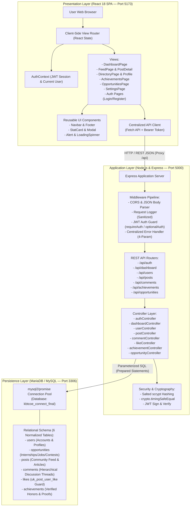
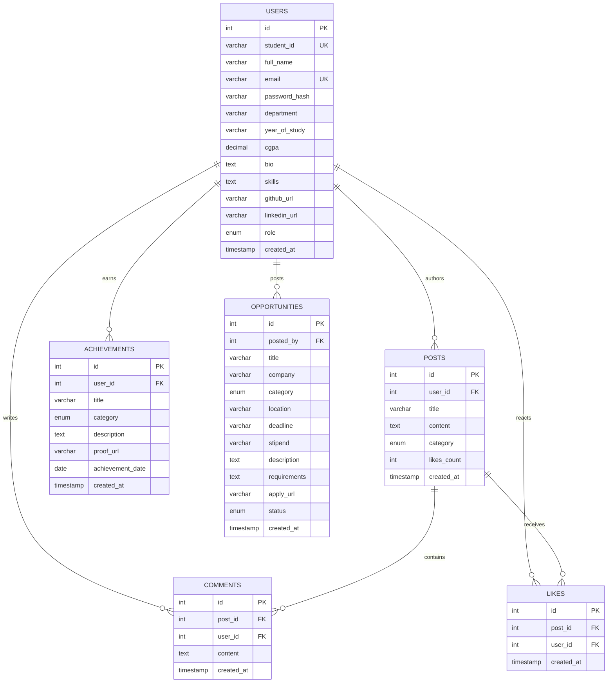

# KBTCOE Connect — Architecture & System Design

## 1. System Overview

**KBTCOE Connect** is architected as an enterprise-grade, decoupled three-tier web application built with **React 18**, **Node.js / Express**, and **MariaDB / MySQL**. Developed progressively through a 16-practical syllabus series, the platform synthesizes all foundational web development concepts into a production-grade student networking portal.



---

## 2. Directory & Component Mapping

The integrated capstone application is located within `assignments/16-KBTCOE_Connect_Final_Project/` and structured cleanly into four core sub-systems:

```text
assignments/16-KBTCOE_Connect_Final_Project/
├── client/                     # Presentation Layer (React 18 + Vite)
│   ├── public/                 # Static branding assets & SVG icons
│   ├── src/
│   │   ├── api/client.js       # Centralized Fetch wrapper with Bearer token injection
│   │   ├── context/AuthContext # React Auth Provider & Session State
│   │   ├── components/         # Reusable modular UI components (Navbar, Modal, StatCard, etc.)
│   │   ├── pages/              # 10 Application pages (Dashboard, Feed, Directory, etc.)
│   │   ├── styles/main.css     # KBTCOE Design System (#1E3A8A, #2563EB, #F8FAFC)
│   │   ├── App.jsx             # Main App layout & client-side routing
│   │   └── main.jsx            # React 18 DOM root mount
│   ├── package.json            # Client dependencies (React 18, Vite)
│   └── vite.config.js          # Vite config with /api proxy to Port 5000
│
├── server/                     # Application Layer (Node.js + Express)
│   ├── config/database.js      # mysql2/promise connection pool & health ping
│   ├── controllers/            # 8 Modular controllers encapsulating business logic
│   ├── middleware/             # authMiddleware, errorHandler, logger, notFound
│   ├── routes/                 # Express REST endpoint routes
│   ├── utils/validators.js     # Cryptographic scrypt hashing & schema validators
│   ├── .env                    # Active runtime environment configuration
│   ├── .env.example            # Template environment variables
│   ├── package.json            # Server dependencies (express, mysql2, jsonwebtoken, cors)
│   └── server.js               # Express application entrypoint & lifecycle
│
├── database/                   # Persistence Layer (MariaDB / MySQL)
│   ├── schema.sql              # DDL schema for kbtcoe_connect_final (6 tables)
│   └── seed.sql                # Synthetic seed dataset (5 users, 6 opps, 5 posts, 6 achievements)
│
├── tests/                      # Verification & Integration Test Suite
│   ├── backend.test.js         # 100/100 End-to-end integration test suite
│   └── regression.test.js      # 15/15 Regression test suite preserving Assignments 01-15
│
└── README.md                   # Complete 21-section laboratory manual & 16 Viva Voce Q&As
```

---

## 3. Communication & Security Architecture

| Interface | Protocol | Data Format | Authentication / Protection |
| :--- | :--- | :--- | :--- |
| **Client -> API Server** | HTTP/1.1 (REST) | JSON | Stateless Bearer JWT (`Authorization: Bearer <token>`) |
| **API Server -> Database** | MySQL Binary Protocol | Parameterized Queries | `mysql2/promise` connection pool with zero SQL string concatenation |
| **Password Storage** | Cryptographic KDF | Salted scrypt hex strings | 32-byte salt, 64-byte key, `crypto.timingSafeEqual` comparison |
| **Ownership Authorization** | Role & ID verification | JSON 403 Forbidden | Author ownership checks (`record.user_id === req.user.id \|\| req.user.role === 'admin'`) |
| **Duplicate Prevention** | Relational Constraint | MySQL ER_DUP_ENTRY | `UNIQUE KEY uk_post_user_like (post_id, user_id)` |
| **Error Handling** | Centralized 4-Param Middleware | Sanitized JSON | Strips stack traces in production; captures syntax & malformed JSON errors |

---

## 4. Database Relational Model (`kbtcoe_connect_final`)


